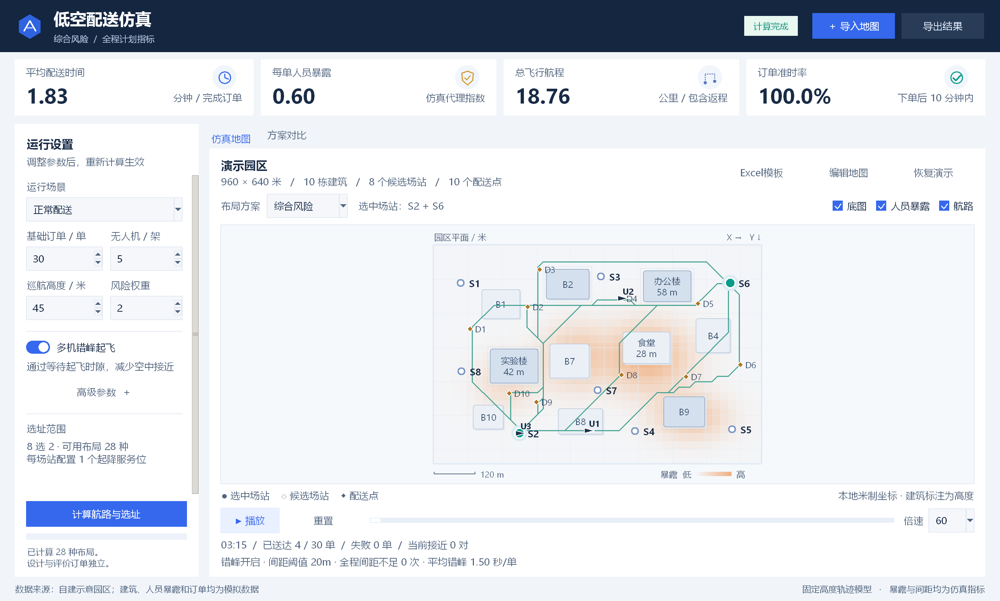
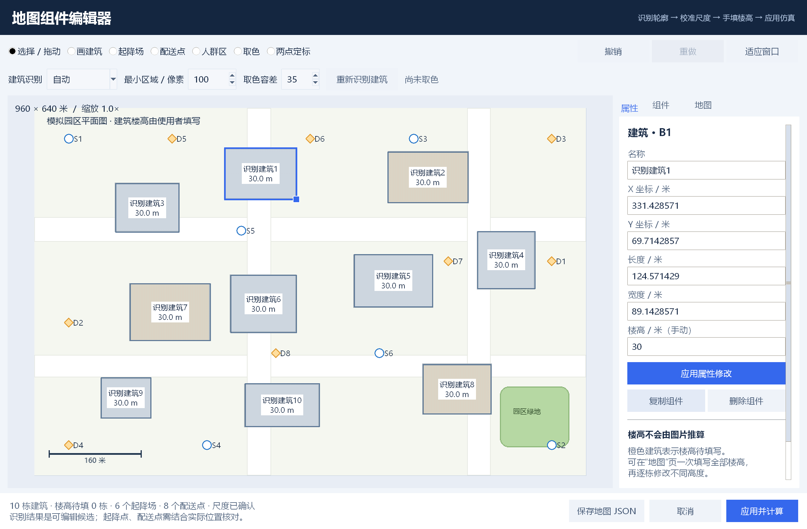

# 低空配送风险仿真与起飞点优选 · Python V0.7

面向园区末端配送的研究仿真原型，支持风险航路规划、两个起降场的组合选址、多机间距检测与错峰调度。核心算法、桌面界面和动画均用Python编写，可离线运行。核心仿真和Excel导入无需第三方Python包；图片识别可选安装Pillow、NumPy和OpenCV，研究图表可选用Matplotlib。

当前提供模拟园区、中文Excel地图模板、可复核实验结果及[参赛实施方案](低空配送仿真项目参赛实施方案.md)。当前模型采用固定巡航高度，尚未进行真实飞行验证。

## 起飞点优选与无人机数量

启动后点击顶部 **“起飞点优选”**，设置无人机数量，再比较从哪些候选位置起飞更合适。**数量可设置1—20架**，同一次比较中各方案使用相同数量和起降服务参数。1架时选择1个起飞点，2—20架时选择2个点并均衡分配，奇数时按候选点顺序前站多一架。修改数量后重新计算，结果会更新并可回到主窗口播放。

工作台提供“固定位置、距离优先、运行优选”的正常/高峰对照、动画回放和完整研究导出。使用原有五表[地图Excel模板](data/地图填写模板.xlsx)或JSON即可。成本、预算和设施等级均不参与此流程；旧地图中的分级字段在这里会被移除。

默认使用3个设计种子，在开启错峰的正常、高峰仿真中选址，再用5个独立种子检验同一位置。8个候选点、5架机时比较28种布局。优化目标依次比较失败率、非准时率、每单超时秒数、配送时间＋30×路径暴露；独立评价不保证每项指标都优于其他方案。

```powershell
python run.py --mode sites --drones 5 --output results/sites_v1
python run.py --mode sites --drones 8 --output results/sites_8
```

操作、评分规则及范围见[起飞点优选](docs/起飞点优选.md)，完整运行证据见[选址独立评价](results/sites_v1/实验分析.md)。V0.6的[分级方案说明](docs/分级起降场第一版.md)及`--mode facility`作为历史实验保留；当前图形入口使用位置优选。滚动调度仍为后续工作。





## 启动

Windows双击 `启动演示.cmd`。启动器优先使用本机已有的配套Python；其他电脑使用Python 3.10以上版本（含Tkinter）。

也可以在本目录打开终端：

```powershell
python run.py
```

选择正常、高峰或空域关闭场景，调整参数后点击“计算航路与选址”。参数较多时使用左侧滚动条。默认开启“多机错峰起飞”，间距阈值20米。关闭错峰可查看基线调度中实际发生的接近事件，回放时用红色圆圈和连线标记。切换开关不会改变设计选出的场站。下拉框或“三种方案对比”页签可切换布局。支持播放、暂停、拖动时间、速度切换与结果导出。参数修改后需重新计算才能回放或导出。

## 上传图片并在程序内编辑地图

点击“导入地图”，选择PNG、JPG、WebP或BMP图片，会生成建筑矩形与道路简图并打开组件编辑器。水体、绿地、运动场和公共空地不加入简图。在“地图”页确认实际宽度或两点定标，手动填写楼高，再点击“应用并计算”。支持修改建筑长宽、道路轮廓，以及起降场、配送点、人群区的增删、拖动、属性编辑和撤销重做。主界面的“编辑地图”同样支持现有Excel和JSON场景。

楼高逐栋手填或批量设置，未填写时阻止计算；初始建议点位需人工核对。可以保存包含底图与组件的JSON，保留草稿并再次打开。当前图片识别适合常见平面地图，复杂卫星图片需要手动修正，不识别真实楼高或人群分布。

图片功能依赖安装：`python -m pip install -r requirements-image.txt`。清华官网导览图按图例区分建筑与地面区域，输出时仅保留建筑矩形和简化道路，可用Windows系统离线OCR生成名称候选。可直接打开[清华紫荆生活区识别草稿](data/真实校园地图/清华大学/清华大学_紫荆生活区_识别草稿.json)或[全校识别草稿](data/真实校园地图/清华大学/清华大学_全校_识别草稿.json)继续核对，尺度与楼高仍待填写。操作和识别范围见[图片地图与组件编辑](docs/图片地图与组件编辑.md)；也可导入[模拟园区图片](data/图片导入示例.png)体验（模拟图宽960米）。



## Excel地图导入

1. 双击 `启动演示.cmd`，点击“获取Excel模板”，保存为“我的地图.xlsx”。
2. 用Excel或WPS打开，修改黄色单元格并保存。模板已预填可直接运行的模拟园区。
3. 在程序右上角点击“导入地图”，选择填好的 `.xlsx`。程序自动校验、加载并重新计算航路与选址。

模板分为“地图设置、建筑、起降场、配送点、人群热点”五张表。通常只需修改地图宽高、建筑位置和楼高、候选起降位置与配送位置；网格和间距可保留默认值。至少填写2个候选起降位置和1个配送位置，人群热点选填。名称可留空，编号由程序生成，需求权重留空按1处理。新记录直接向下添加，删除示例时删除数据行或清空整行，请保留第5行表头。

坐标全部使用米：左上角为 `(0,0)`，X向右、Y向下。建筑坐标指矩形左上角，长度沿X方向，宽度沿Y方向。单元格只填数字，不附加“米”等单位；公式请复制粘贴为数值。截图可按上节导入编辑，楼高仍须手填；经纬度、GIS图层需要先转换为本地米制数据。

数据填写有误时提示工作表、行号和字段；原地图和结果保留。成功加载后会显示地图名称、尺寸、来源及要素数量。导入为数据快照，修改磁盘上的Excel后需要再次点击“导入地图”；调整仿真参数时继续使用已加载的数据。点击“恢复演示地图”可切回内置园区。

同一按钮也支持原有 `.json` 地图。Excel导入使用Python标准库，无需安装额外依赖；命令行同样支持 `python run.py --scene "data/地图填写模板.xlsx"`。内置模板位于 `data/地图填写模板.xlsx`。

## 界面与操作

Windows启动时启用原生高DPI显示，字体、控件和地图标注随系统缩放适配，避免整体位图放大导致发虚。文字加深、地图小标注增大；编辑器缩放和平移时按可视区域重采样底图，保持底图与组件对齐。修改后需关闭旧程序再启动。

界面使用深蓝顶栏、浅灰背景和四张指标卡片。左侧集中展示场景、订单量、机队、巡航高度、风险权重及错峰开关；“高级参数”展开间距阈值和评价种子。底部计算按钮固定显示，参数区可用鼠标滚轮浏览，右上角状态提示区分正在计算、计算完成与参数待应用。

“仿真地图”默认只画需要绕行的建筑矩形与道路，原图保留在编辑器中用于核对和定标。建筑高度加垂直间距达到巡航高度时才显示为障碍；较低建筑的记录保留，降低巡航高度重算后会重新参与避障。矩形采用原轮廓的外接范围，可能保守覆盖轮廓外的空地；航路规划使用同一矩形。地图带米制比例尺，名称和人员暴露图层默认关闭，悬停仍可查看详情。SVG导出同样使用简图。“方案对比”展示指标表、配送时间与人员暴露条形图；点击表格中的方案可切换布局，窗口较小时可横向滚动表格。计算过程在后台线程执行。

地图上方的“地图视图”提供`− / ＋`、缩放百分比和“适应窗口”。在地图上滚动鼠标滚轮可围绕鼠标位置放大到12倍，按住左键或右键拖动平移；点击“适应窗口”或双击地图恢复全图。右侧“建筑名称”默认不勾选，按需打开可查看名称、编号及楼高文字。切换布局、回放或重新计算同一地图时保留当前视角及名称开关；导入另一张地图时自动恢复全图。主简图不叠加原图片及其印刷文字。

已检查1380×830与1120×720两种窗口大小下的固定按钮、高级参数、滚轮、地图详情、图表和表格滚动，详见[验证记录](docs/验证记录.md)。

## 多机间距与错峰仿真

- 连续时间多机间距检测，包含去程、配送悬停、返程和返场等待悬停。
- 根据已预约航迹推迟新任务出发；错峰等待和场站等待分列。搜索到达等待上限仍无可行时隙时计为失败。
- 基线与错峰共90条运行指标、45组配对实验，完整数据和分析见 `results/safety/实验分析.md`。
- 当前模拟场景的配对实验中，间距不足事件合计700次→0次，所有订单完成；按运行等权平均的配送时间增加35.53秒。此结果针对同高度、匀速折线与悬停模型，不代表真实航空避碰验证。

## 不打开界面的实验

```powershell
python run.py --mode single
python run.py --mode single --scenario closure --altitude 30 --risk-weight 3 --seed 20261016
python run.py --mode batch
python run.py --mode safety
python run.py --mode single --no-deconflict
python -m unittest discover -s tests -v
```

在本机也可以运行 `powershell -ExecutionPolicy Bypass -File .\launch.ps1 -Mode batch`。

单次结果保存在 `results/single`，包含完整的 `result.json`、指标对比 `comparison.csv`、任务明细 `jobs.csv`、失败订单及分类 `failed.csv`、连续接近事件 `conflicts.csv`、地图 `map.svg`、对比图 `comparison.svg`。SVG可直接用浏览器打开或插入支持SVG的演示软件。CSV使用UTF-8 BOM编码，便于Excel读取。

批量默认执行3种场景×5个评价种子×3种布局，共45条方案评价记录；结果位于 `results/batch`。`runs`保存每次完整仿真；`raw_metrics.csv`保存每次指标；`summary.csv`包含均值、样本标准差与有效运行次数；`batch_comparison.svg`展示三类主要指标。默认评价种子为20261015至20261019，设计种子固定20365744。每个场景选址一次，再用所有评价订单检验同一布局。场景改变会重新设计选址，因此此实验不是“同一布局抵抗突发事件”的鲁棒性实验。标准差不等于置信区间。

`--mode safety`将同一场景、种子与布局下的基线和错峰调度配对，输出 `results/safety/raw_metrics.csv`、`paired_comparison.csv`、`summary.csv`、30份完整JSON和自动分析报告。两种调度的订单、航路、站点和机队保持一致。新增命令行参数：`--separation 20`、`--departure-step 5`、`--max-airspace-delay 600`；使用 `--no-deconflict` 关闭错峰，但仍检测和导出冲突。

可选的研究图表使用Matplotlib，核心程序仍无需第三方包：

```powershell
python -m pip install -r requirements-analysis.txt
python plot_study.py
```

输出PNG与矢量PDF到 `results/safety`。默认图表显示跨种子均值和样本标准差，覆盖冲突、配送时间、人员暴露、准时率四类指标。

自定义种子、数据和目录：

```powershell
python run.py --mode batch --seeds 101,102,103,104,105 --design-seed 200 --output results/my_batch
python run.py --mode single --scene data/demo_scene.json --output results/my_run
```

## 模型与适用范围

- **场景**：默认960×640米模拟园区、10栋建筑、8个候选起降场、10个配送点。可用“导入地图”加载Excel模板或JSON替换场景；坐标使用本地米制坐标，不直接接收经纬度。
- **通行条件**：固定巡航高度；建筑高度加5米不低于巡航高度时，建筑及8米平面间距需要绕行。这些间距是模型参数，不是法规标准。
- **A***：16米网格、八邻域、不斜穿阻塞拐角。边代价为 `距离 × (1 + 风险权重 × 路段中点暴露值)`；启发函数为到目标网格节点的欧氏距离。对已选起终接入节点和当前离散图求最小代价，不保证连续三维空间的全局最优。接入节点在邻近5×5网格内选最近可达点，窄通道可能因离散化而被判为不可达。连接线按不超过3米间隔采样检查，不是精确CAD碰撞检测。
- **风险场**：基础值0.035与多个二维高斯人群热点叠加，上限1。路径暴露为路段长度乘以中点暴露之和；每单风险指数为往返暴露积分除以100，仅为人工缩放的代理指标，不能解释为事故概率。
- **原有三方案选址**：枚举可行场站的两两组合。默认固定布局S1+S5；距离优先最小化设计订单总航程；综合方案对所有候选布局的风险、时间、航程、起降等待做min-max归一化，权重0.45、0.30、0.15、0.10，不可达订单每单惩罚1000。该入口仍使用基线调度选址。“起飞点优选”入口将间距约束与正常、高峰需求纳入选址评价，支持1—20架无人机，详见新文档。所有方案使用同一A*规划器，距离优先指选址目标。固定场站不可用时依序补充可用站点。
- **调度**：订单按下单时间处理，在有可达航路的无人机中选择最早送达者。无人机固定归属场站；5架飞机在2个场站按顺序分配，通常为3+2。每场站一个起降服务位，起飞25秒、降落20秒、配送处理20秒、速度9米/秒。日历预约避免同一服务位与同一无人机任务重叠；采用预约式先到订单调度，不保证全局最优调度。起降等待指场站排队，不包含等待无人机空闲的全部时间。返回时沿去程反向飞行。
- **多机间距**：解析求解重叠运动区间中的相对距离二次不等式，记录距离严格低于阈值的连续事件、最小距离和时间。起飞准备与降落服务视为地面阶段，出发至开始降落期间包含配送悬停及返场悬停。阈值20米为研究参数，不是法规标准。
- **错峰**：基于已有预约，按默认5秒步长推迟新任务准备时间，场站服务日历可能进一步推迟。默认最大额外等待600秒；无可行候选的订单记为 `airspace_delay_limit` 失败，可达性失败记为 `unreachable`。错峰等待等于相对原最早起飞准备时隙的额外推迟，场站等待为原起飞排队与返场排队之和。两项之和等于无人机就绪后的起飞等待加返场等待。悬停电耗及悬停人群暴露尚未计入能耗或路径暴露指标。
- **订单与评价**：正常30单在1200秒内到达；高峰为双倍订单、800秒内到达。600秒内送达视为准时，不可达订单纳入未完成、未准时分母。平均时间、平均暴露按成功订单计算，需与完成率、失败数一起报告。
- **关闭场景**：默认矩形x=470、y=200、宽75、高150米，整次运行关闭；自定义地图按宽高比例缩放该演示关闭区。尚未实现途中突发关闭与动态重规划。
- **尚未覆盖**：真实爬升下降与避碰、导航误差、天气、电池、真实动力学、实际事故概率，以及经实测校准的校园尺度、楼高和人群数据。已提供真实清华导览图的识别草稿，仍需人工核实。理想运动模型下无间距不足不表示完成真实飞行安全验证。

为核对语言迁移，订单生成器与搜索队列的平局处理沿用旧版规则。关闭错峰时，默认场景的场站组合和原有主要指标与JavaScript初版一致。多种子实验固定设计种子，不随评价种子重新选址。

## MATLAB可选分析

MATLAB不是运行依赖。安装MATLAB R2020a以上版本后，将 `matlab` 目录添加到路径并执行：

```matlab
analyze_results('C:\你的目录\低空配送仿真Python版\results\single')
```

脚本读取Python导出的JSON，绘制三方案指标对比和风险航路图，导出PNG与对比图PDF。使用MATLAB基础功能，不需要额外工具箱。本机尚未发现MATLAB，因此附带脚本未经MATLAB实际运行验证。

## 文件与参赛下一步

- `engine.py`：核心模型、A*、选址、调度和轨迹插值。
- `site_selection.py`、`site_ui.py`：可调无人机数量的起飞点优选、独立评价和图形工作台。
- `facility.py`、`facility_schema.py`：分级设施约束、联合配置枚举、多种子设计与独立评价。
- `facility_ui.py`、`facility_template.py`：分级工作台与六表Excel模板。
- `airspace.py`：线性轨迹分段、解析间距检测与连续事件合并。
- `study.py`：配对实验与自动分析报告。
- `plot_study.py`：可选Matplotlib图表。
- `app.py`：Tkinter界面与回放；计算线程不直接操作界面。
- `ui.py`：界面主题、参数面板、地图绘制与方案对比图。
- `map_import.py`：Excel地图读取、中文字段映射与填写错误定位，使用标准库。
- `image_map.py`：图片导入、原图嵌入及模拟建议点位。
- `campus_recognition.py`：图例配色分类、多边形建筑及地物提取，使用可选Pillow、NumPy和OpenCV。
- `flight_map.py`：飞行简图转换、建筑矩形、道路概括及按巡航高度筛选障碍，使用标准库。
- `map_geometry.py`：共享多边形、内部空洞、碰撞与绘制几何，使用标准库。
- `map_ocr.py`、`map_ocr.ps1`：可选Windows离线OCR名称候选。
- `map_document.py`：组件编辑、校验、撤销重做、定标和JSON保存。
- `map_editor.py`：可视化组件编辑器与手动楼高输入。
- `run.py`：图形、单次、批量入口。
- `reporting.py`：数据导出与SVG图表。
- `data/demo_scene.json`：场景输入。
- `matlab/analyze_results.m`：可选MATLAB绘图。
- `tests/test_engine.py`：模型核验。
- `tests/test_airspace.py`：亚秒交叉、悬停、相切、时间无重叠、连续事件合并、错峰与超限失败检查。
- `tests/test_map_import.py`：实际模板与JSON计算一致、单元格错误定位、公式拒绝、默认值、共享字符串、表头校验与地图快照检查。

## 本机核验（2026-10-15）

使用Python 3.12.14运行，28项模型与导入测试全部通过，包括独立Dijkstra最优代价对照和亚秒交叉检测。2026年10月16日上传准备时已再次运行并通过。V0.2迁移时已核对默认三种布局、评价订单、主要指标和80条航路与原网页一致；V0.3保存了90条运行指标与45组配对实验。Tkinter界面及V0.4地图导入的历史检查范围见[验证记录](docs/验证记录.md)。Matplotlib图表已生成并检查；`plot_metadata.json`记录绘图库版本和汇总数据校验值。正式程序与模型测试不依赖Pillow。

参赛前仍需真实场景数据及来源、参数依据、真实应用价值说明、报告与答辩材料。按赛事要求披露AI辅助代码与材料制作的使用方式。本目录是可运行研究原型，不能将模拟结果写成实际工程验证结果。
