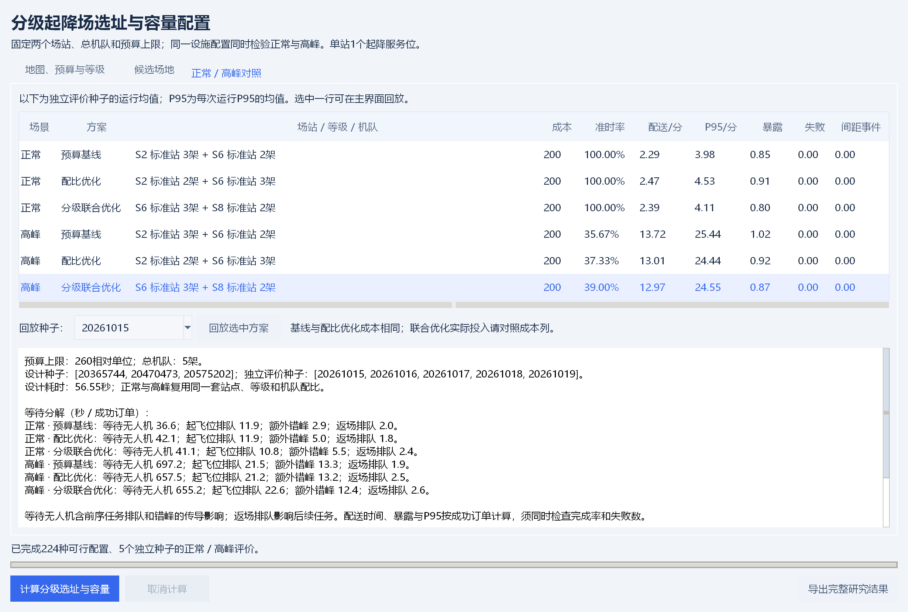

# 分级起降场选址与容量配置 · 第一版

历史版本说明：当前V0.7图形入口已按需求改为[起飞点优选](起飞点优选.md)，可设置1—20架无人机，成本和等级不参与选址。本文记录V0.6；其命令行与历史结果保留用于复核，原“分级选址”图形入口已替换。

交付日期：2026年10月18日，软件版本V0.6。第一版完成预算约束下两个场站的位置、设施等级、无人机配比联合选择，以及同一配置在正常、高峰下的独立检验。保留现有风险航路规划、预约错峰、多机间距检测、地图编辑和动画回放。

## 操作流程

1. 双击项目根目录的 `启动演示.cmd`，点击顶部 **分级选址**。
2. 在“地图、预算与等级”页设置预算、无人机总数、订单量、设计及评价种子，按需修改等级参数。可加载原有地图，或加载 `data/分级起降场示例.json`、`data/分级起降场填写模板.xlsx`。参数较多时使用右侧滚动条。
3. 在“候选场地”页选中候选点，填写允许等级和附加成本，点击“应用场地设置”。允许等级填写编号，以逗号分隔；留空代表禁用该点。
4. 点击底部“计算分级选址与容量”。后台运行支持取消；默认案例设计约1分钟，规模、电脑和种子数量会影响耗时。
5. “正常 / 高峰对照”页展示六行结果。选中方案及评价种子，点击“回放选中方案”，可在主窗口播放、暂停、拖动时间并切换方案。结果明细展示等待无人机、起飞位排队、额外错峰和返场排队。
6. 点击“导出完整研究结果”保存全部数据。修改参数后需重算；“保存场景JSON”可保存输入供下次加载。普通主窗口的“计算航路与选址”仍执行原有三方案流程，分级设计请从工作台计算。

## 默认等级与约束

| 编号 | 等级 | 建设成本 | 最大驻机数 | 起飞服务/秒 | 降落服务/秒 |
| --- | --- | ---: | ---: | ---: | ---: |
| standard | 标准站 | 100 | 3 | 25 | 20 |
| enhanced | 增强站 | 160 | 10 | 25 | 20 |

预算上限260，总机队默认5架。成本为相对单位，容量、时间均为模型假设，参数来源随场景与结果保存。两级默认的运行速度相同，增强站只提高可驻机上限；提高机队规模时等级约束会影响可行性。可编辑各级服务时间，调度会实际使用这些数值。

每个启用站至少1架无人机，无人机固定归属场站，总数保持不变。所选等级必须属于候选点的允许集合，分配数量不得超过等级驻机上限。实际建设成本等于两站等级成本及两站场地附加成本之和，不超过预算。两站各使用1个共享起降服务位。

枚举允许的站点对、等级与正整数机队配比。预算、适建性或驻机容量无解时给出错误；可行配置超过5000种时提示缩小规模。缓存只合并站点、配比、服务时间完全相同的运行仿真，仍保留所有等级配置和成本记录。

## 三方案与评分

| 方案 | 设计规则 | 对照含义 |
| --- | --- | --- |
| 预算基线 | 优先保留原有均衡机队配比，用原正常场景综合选址评分选择预算内布局，再比较成本 | 提供满足预算和容量约束的参照 |
| 配比优化 | 固定预算基线的站点、等级和实际花费，优化机队分配 | 单独查看机队配比贡献 |
| 分级联合优化 | 在全部预算可行配置中选择评分最优者 | 同时选择位置、等级、配比；实际花费单独展示 |

所有新配置均在开启错峰的真实调度中评价。按以下顺序逐项比较，前一项相同才比较后一项：

1. 失败订单比例。
2. 未准时比例（失败订单也计入未准时）。
3. 超时秒数之和除以总订单数。
4. 平均配送时间 + 30 × 平均路径暴露指数。

正常与高峰、各设计种子均等权。最后一项中的30是人为设置的时间与暴露权衡系数，不能解释为事故损失估计。评分相同则优先成本较低者，再按固定编号次序打破平局。这里的最优仅指给定有限候选集合、设计样本及评分规则中的最优。

默认3个设计种子为20365744、20470473、20575202；后续种子按固定间隔104729生成，最多5个。设计结束后冻结位置、等级与机队配比，使用20261015至20261019共5个独立评价种子。禁止把任一设计种子用作评价种子。界面和命令行可修改种子。

## 输入格式

原有JSON/Excel未填写设施参数时自动使用默认等级与预算。

JSON的顶层增加以下对象；候选点可增加 `allowed_levels` 与 `site_cost`：

```json
{
  "facility_planning": {
    "budget": 260,
    "parameter_source": "演示假设：成本为相对单位；容量和服务时间为模型设定",
    "levels": [
      {"id": "standard", "name": "标准站", "cost": 100,
       "max_drones": 3, "takeoff_service": 25, "landing_service": 20},
      {"id": "enhanced", "name": "增强站", "cost": 160,
       "max_drones": 10, "takeoff_service": 25, "landing_service": 20}
    ]
  }
}
```

以上是增量字段片段，完整地图仍需宽高、建筑、起降场、配送点等字段，见示例。候选点例如 `{"id":"S1","name":"西站","x":80,"y":100,"allowed_levels":["standard"],"site_cost":10}`；不写 `allowed_levels` 代表允许全部等级，空列表代表禁用，`site_cost` 默认0。

等级支持1—4种，编号唯一，最大驻机数为1—20的整数，起降服务时间须大于0，建设成本与附加成本非负，参数来源须非空。界面可编辑导入等级的参数，增加或删除等级需编辑JSON或Excel后重新加载。

分级Excel模板共六张表，在原五张地图表上新增“场站等级”：B2预算、B3参数来源、第5行表头、第6行起填写等级。原“起降场”表新增D列“允许等级”、E列“场地附加成本”。D列可填写 `standard,enhanced`，留空或写“禁用”代表禁用该候选点；新增数据行时需填写允许等级。旧五表模板无该列时允许全部等级。请保留表头并填写数值，公式会被拒绝，以避免使用过期缓存。

## 复现与导出

```powershell
python run.py --mode facility --scene data/分级起降场示例.json --budget 260 --output results/facility_v1
python run.py --mode facility --scene data/分级起降场填写模板.xlsx --design-seed-count 3 --seeds 101,102,103 --output results/my_facility
python -m unittest discover -s tests -v
```

`results/facility_v1` 保存本次完整运行证据：

| 文件 | 内容 |
| --- | --- |
| study.json | 输入、所有可行配置、设计评分、全部评价轨迹和汇总 |
| scene.json | 可重新导入的场景快照 |
| configurations.csv | 最终三方案及实际成本 |
| design_candidates.csv | 所有可行配置的设计场景均值与评分 |
| raw_metrics.csv / summary.csv | 30条运行指标；6组均值、样本标准差及有效运行数 |
| runs/场景_种子/ | 每次三方案完整JSON、CSV、地图和对比SVG；含各站等级、配比和服务时间 |
| manifest.json | 设计及评价种子、运行参数、导出时核心源码与场景SHA256 |
| 实验分析.md | 自动生成的结果与等待分解报告 |

源码校验值标记导出时的代码快照，不包含全部运行环境。P95采用每次运行成功订单的最近秩分位数；汇总的是各次P95的均值，不是合并所有订单的P95。标准差属于样本离散程度，不是置信区间。平均配送时间及暴露只计成功订单，必须同时看完成率和失败数。

## 默认案例结果



8个候选点，5架无人机，预算上限260，可行配置224种、不同运行配置112种。正常30单在1200秒内到达，高峰60单在800秒内到达，以600秒为准时时限。以下为5个独立评价种子的运行等权均值。

| 场景 | 方案 | 两站机队配置 | 实际成本 | 准时率 | 平均配送/秒 |
| --- | --- | --- | ---: | ---: | ---: |
| 正常 | 预算基线 | S2标准3 + S6标准2 | 200 | 100.00% | 137.15 |
| 正常 | 配比优化 | S2标准2 + S6标准3 | 200 | 100.00% | 147.93 |
| 正常 | 分级联合优化 | S6标准3 + S8标准2 | 200 | 100.00% | 143.35 |
| 高峰 | 预算基线 | S2标准3 + S6标准2 | 200 | 35.67% | 823.26 |
| 高峰 | 配比优化 | S2标准2 + S6标准3 | 200 | 37.33% | 780.37 |
| 高峰 | 分级联合优化 | S6标准3 + S8标准2 | 200 | 39.00% | 778.18 |

高峰联合方案比预算基线准时率提高3.33个百分点，平均配送时间减少45.08秒，约5.48%；正常平均时间增加6.20秒。三方案所有运行完成率100%，模型内间距不足事件为0。高峰仍有严重排队，设施优化的改进幅度有限。

本例没有选择增强站，因为当前约束与样本下两个标准站更划算；不能据此宣称升级设施带来性能提升。容量约束测试另验证8架机、预算260时可行配置必须包含增强站，等级确实影响可行集合。相同调度器贯穿所有新方案，因此这里比较的是设施和配比选择，没有分离证明调度算法创新。

## 后续边界

第一版使用固定高度、理想匀速折线和悬停模型。所有订单假设可从任一已选站发出，没有库存、补货、站间运输、滚动重排、多起降位、天气、电池和真实飞行动力学。悬停电耗与悬停人群暴露未纳入指标；参数需用真实场景资料校准。

后续优先增加高峰滚动调度及配对消融实验，再研究机队规模、预算和设施服务能力的敏感性。借鉴往年《分级垂直起降机场的选址问题》的设施分级与容量配置思路，目前仅核实题目和获奖信息，未取得该作品模型或代码，本版不构成其算法复现。软件、代码和文档使用生成式AI辅助，结果应经人工复核。
