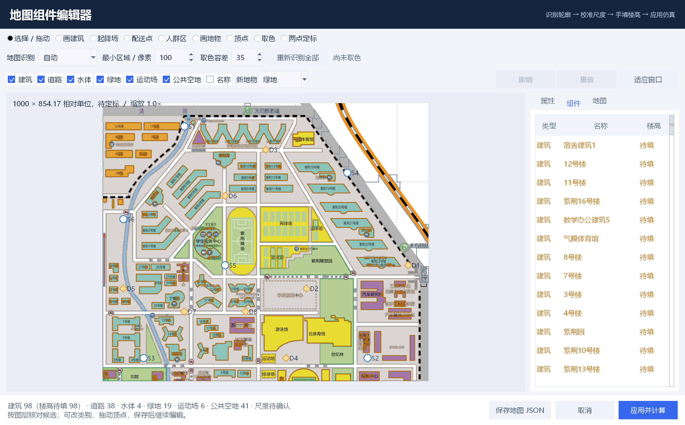

# 图片地图导入与组件编辑

## 从一张图片开始

1. 双击项目中的`启动演示.cmd`，点击右上角“导入地图”，选择PNG、JPG、WebP或BMP地图图片。
2. 程序在本机生成建筑矩形与道路简图，打开“地图组件编辑器”。水体、绿地、运动场及公共空地不加入输出。可以使用[清华大学局部地图识别草稿](../data/真实校园地图/清华大学/清华大学_紫荆生活区_识别草稿.json)，或[模拟园区图片](../data/图片导入示例.png)（模拟图宽960米）。清华地图的实际尺度尚未校准。
3. 打开右侧“地图”页，输入整张图片对应的实际宽度并点击“确认宽度并等比定标”。如果只有局部已知距离，使用顶部“两点定标”：依次点击两个位置，再输入它们之间的实际距离。
4. **手动填写楼高。** 可以选中建筑在“属性”页逐栋输入，也可以在“地图”页输入一个楼高并点击“应用全部”，再修改个别建筑。批量设置会覆盖所有建筑楼高，支持撤销。
5. 核对建筑矩形及道路，删除误检或补画遗漏障碍，检查或调整建议起降点与配送点；根据研究场景自行添加人群区。
6. 点击“保存地图JSON”保留原始底图和全部组件；点击“应用并计算”将修改用于航路、选址与配送仿真。

图片导入需要Pillow、NumPy和OpenCV。其他电脑可按下面的方式安装：

```powershell
python -m pip install -r requirements-image.txt
```

Excel、无图片的JSON地图与核心仿真仍可使用Python标准库运行。Windows若已安装中文OCR语言包，还会自动调用系统离线OCR生成名称候选；未安装时仍可识别轮廓、手动填写名称。

## 各类组件怎么修改

| 组件 | 可以修改的内容 | 鼠标操作 |
| --- | --- | --- |
| 建筑 | 名称、X/Y、长宽、手动楼高 | 拖动移动；拖右下角控制点调整长宽；“画建筑”补充遗漏建筑 |
| 地物 | 名称、类别、X/Y、长宽 | 新导入简图只保留道路；“画地物”可补充道路，旧地图仍可编辑其他类别 |
| 候选起降场 | 名称、X/Y | 选择工具拖动；“起降场”工具点击新增 |
| 配送点 | 名称、X/Y、需求权重 | 拖动移动；“配送点”工具点击新增 |
| 人群区 | 名称、中心X/Y、两个半径和强度 | 拖动移动；拖右下角控制点调整半径；“人群区”工具拖出新区域 |

右侧“组件”页可以从列表选择对象；“属性”页填写数值后点击“应用属性修改”。组件可复制、删除，也可撤销与重做。滚轮缩放地图，鼠标右键拖动平移，“适应窗口”恢复全图。较小窗口下，右侧属性和地图设置支持滚动。

新导入建筑用原轮廓的外接矩形概括，道路保留主要走向，删去细碎转折和文字造成的小孔洞。矩形可能覆盖原建筑轮廓外的空地，属于保守近似；主程序计算航路时使用相同矩形。旧多边形地图仍可在编辑器中修改顶点和内部空洞，应用到主程序后统一转为简图。移动、缩放、定标和保存时道路轮廓一同更新。

顶部复选框可单独隐藏建筑或某一类地物，关闭“名称”可减少标签遮挡。选中地物可在“属性”页改变类别，或点击“将选中地物转为建筑”；建筑可转为顶部“新地物”所选类别。转为建筑须另填楼高；进入主简图时仅保留建筑矩形和道路。

新版底图保留至最长边3072像素，小于此尺寸的图片保持原分辨率；大图等比缩小后嵌入JSON。显示时采用高质量重采样。旧JSON中已经缩小的底图仍可打开，但丢失的细节需要重新导入清晰原图才能恢复；建议先另存现有编辑成果。

普通Excel和JSON地图也能点击主界面的“编辑地图”修改，编辑时不会直接改写原Excel。可以另存为可编辑JSON地图，之后继续导入。

## 识别结果不理想时

- 清华官网地图优先选择“自动”。识别器结合图例配色、轮廓形状和可用的本地文字候选，区分教学楼、宿舍、住宅、体育建筑及各类地面区域。
- 其他简单平面图可根据建筑填充颜色选择“灰色建筑”“暖色建筑”或“蓝灰建筑”。手动建筑模式同样输出矩形建筑与道路。
- 颜色特殊时，选择顶部“取色”，点击原图中建筑的填充区域，再点击“重新识别全部”；取色容差控制手动建筑颜色允许的差异。
- “最小区域”越大，越容易过滤文字与细碎图案，也越容易漏掉小建筑。
- 误识别的组件可以改类别或删除，遗漏区域可手绘补充；重新识别会替换全部建筑和地物，并清除楼高，起降场、配送点和人群区保留，该操作可撤销。

当前识别使用本地颜色分割、形态过滤、多边形轮廓和可选离线OCR，适合配色明确的平面导览图。分析图最长边2400像素，原图允许至8000万像素；清华官网5594×7861原图可以直接导入。自动校园图模式已取消原先160个建筑的截断。运动场内部草坪和白色标线归入运动场，校外白色纸面不直接作为道路。

输出是可编辑候选，不能承诺整图无遗漏：印刷标签遮挡、相连建筑、很小的建筑和共用配色仍可能导致漏检、合并或误分类；OCR名称也需核对。其他地图及卫星照片不保证达到清华导览图的识别效果。

默认飞行简图及SVG只显示道路和需要绕行的建筑，原图及其文字仅在编辑器中核对。建筑高度加垂直间距大于或等于当前巡航高度时参与显示与避障；较低建筑保留在数据中，降低高度重算后可重新出现。名称默认隐藏，仍可悬停查看详情；主地图支持滚轮放大、按钮缩放、拖动平移和“适应窗口”。道路保留为参照，不参与碰撞，也不自动生成人群强度；人员暴露图层可按需打开。


旧版多类编辑能力的截图（当前新导入默认输出建筑矩形与道路）：



## 手动输入与数据含义

- 楼高不会从截图推测。橙色轮廓及“楼高待填”表示该建筑未完成填写，程序会阻止计算。手动明确输入0米是有效数值，不会被当作缺失。
- 图片像素不自带真实米制尺度。输入实际宽度或完成两点定标后才允许计算；平面定标不会改变已经手动填写的楼高。
- 初始自动生成的起降场和配送点只是空地区域内的模拟建议位置，需结合实际业务核对。人群分布不会从图片臆造，需要自行添加。
- 保存时会把缩小的原图嵌入JSON文件，因此移动JSON或删除原图片后仍可编辑与查看。源文件不需要继续留在固定路径，图片不会发送到外部识别服务。
- 楼高或尺度未填完时仍可以保存草稿。下次导入该JSON会重新进入编辑器，补齐后再计算。
- 点击“取消”会保留原仿真地图和结果；只有“应用并计算”成功后，修改才成为当前运行场景。

正式场景应记录图片来源、尺度依据、楼高测量或估计方法，并区分真实空间资料与模拟点位、需求和人群数据。
