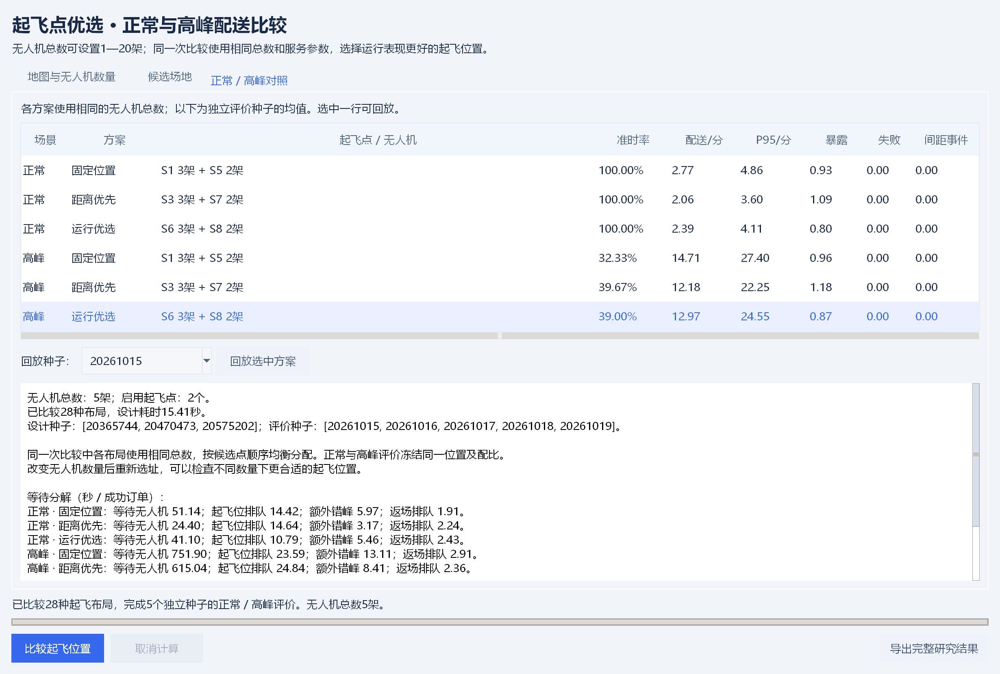

# 起飞点优选与可调无人机数量

2026年10月18日，V0.7。当前工作台根据配送表现选择起飞位置，无人机数量由用户设置。

## 使用

1. 双击 `启动演示.cmd`，点击顶部 **起飞点优选**。工作台首次打开时继承主窗口的无人机数量。
2. 在“地图与无人机数量”页设置无人机总数，可填写1—20的整数。订单量、巡航高度、风险权重及间距阈值同样可调。
3. 可加载普通Excel或JSON地图；候选位置在“候选场地”页查看，增删、移动可通过主窗口“编辑地图”完成。旧分级地图中的等级、成本、预算字段不会参与本流程，保存出的选址地图会移除这些字段。
4. 点击“比较起飞位置”，后台计算完成后展示正常、高峰各三种方案。修改无人机数量后旧结果标记为待重算，回放和导出暂不可用。
5. 选择结果行与评价种子，点击“回放选中方案”，主窗口会载入对应数量的真实无人机轨迹，并更新数量参数。可播放、暂停、拖动时间和切换方案。
6. “导出完整研究结果”保存本次无人机数量、全部候选布局评分、正常/高峰评价、指标及轨迹。保存场景JSON仅保存地图，运行参数随研究结果导出。



## 数量与分配规则

| 无人机数量 | 选中位置数 | 每处无人机数量 |
| --- | ---: | --- |
| 1 | 1 | 1 |
| 3 | 2 | 2＋1 |
| 5 | 2 | 3＋2 |
| 8 | 2 | 4＋4 |
| 20 | 2 | 10＋10 |

同一次比较里各布局使用相同总数，各站起降服务时间相同。按地图候选点顺序均衡分配，奇数时前站多一架；本版不额外搜索全部机队配比。数量变更后重新生成分配、运行仿真并选址。无人机固定归属场站，正常和高峰使用同一位置与分配，以便检验同一布局承受需求变化的表现。

无人机数量不是按需求自动确定，程序也不保证更多飞机必然让所有指标变好；起降位与间距约束仍会形成瓶颈。

## 如何判断位置

固定高度A*航路避让建筑，使用同一风险场和错峰调度。障碍内的候选点不参与选址；候选布局超过5000种时提示缩小规模。1架时枚举单点，其余数量枚举两点组合。

三种对照方案：

- **固定位置**：优先取S1、S5；不可用时按地图顺序补足。
- **距离优先**：根据正常设计订单，先比较失败订单数，再比较总航程。
- **运行优选**：正常、高峰等权，按失败率、非准时率、每单超时秒数、平均配送秒数＋30×平均路径暴露，依次比较并选取设计样本中评分最优的布局。30为人为权衡系数。

默认设计种子20365744、20470473、20575202，评价种子20261015至20261019。设计和评价种子必须不同；独立评价过程中不重新选址。所有方案使用同一评价订单流。独立样本表现可能不同于设计排序，不保证运行优选在测试中超过距离优先或固定位置。

## 命令行与结果

```powershell
python run.py --mode sites --drones 3 --output results/sites_3
python run.py --mode sites --drones 5 --output results/sites_v1
python run.py --mode sites --drones 8 --scene data/地图填写模板.xlsx --output results/sites_8
```

当前默认5架、8个候选点，共28种布局。完整结果位于 `results/sites_v1`：`study.json`保存输入、全部候选评分与评价轨迹，`summary.csv`保存均值、样本标准差和有效运行数，`raw_metrics.csv`保存每次指标，`design_candidates.csv`保存候选设计评分，`scene.json`可重新导入。各次 `runs/场景_种子/site_configurations.csv`列明每个位置的无人机数，`manifest.json`记录参数、种子与导出源码校验值。

默认案例的5个独立评价种子，运行等权均值如下：

| 场景 | 方案 | 起飞位置与数量 | 准时率 | 平均配送/秒 |
| --- | --- | --- | ---: | ---: |
| 正常 | 固定位置 | S1 3＋S5 2 | 100.00% | 166.12 |
| 正常 | 距离优先 | S3 3＋S7 2 | 100.00% | 123.71 |
| 正常 | 运行优选 | S6 3＋S8 2 | 100.00% | 143.35 |
| 高峰 | 固定位置 | S1 3＋S5 2 | 32.33% | 882.68 |
| 高峰 | 距离优先 | S3 3＋S7 2 | 39.67% | 731.00 |
| 高峰 | 运行优选 | S6 3＋S8 2 | 39.00% | 778.18 |

该测试样本中距离优先的配送时间、准时率优于运行优选，说明设计评分与独立样本存在取舍，仍需扩充需求样本与敏感性分析。全部运行完成率100%，模型内间距事件0；高峰仍有明显积压。

平均配送、暴露及P95按成功订单统计，需同时看完成率和失败数。汇总P95是每次运行最近秩P95的均值；样本标准差不是置信区间。

本程序为固定高度、理想运动的研究仿真。各站1个起降服务位，所有订单可从任一选中位置发出，无滚动调度、库存、天气、电池及真实飞行验证。历史分级成本实验单独保留，不作为当前位置选择依据。
