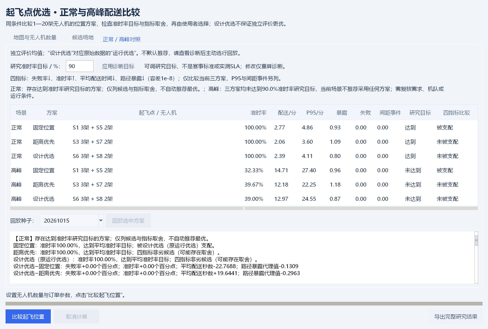

# 起飞点优选与可调无人机数量

2026年10月19日，V0.7第二轮。原模拟与选址算法保留；工作台新增评价后的决策诊断，无人机数量由用户设置。

## 使用

1. 双击 `启动演示.cmd`，点击顶部 **起飞点优选**。工作台首次打开时继承主窗口的无人机数量。
2. 在“地图与无人机数量”页设置无人机总数，可填写1—20的整数。订单量、巡航高度、风险权重及间距阈值同样可调。
3. 可加载普通Excel或JSON地图；候选位置在“候选场地”页查看，增删、移动可通过主窗口“编辑地图”完成。旧分级地图中的等级、成本、预算字段不会参与本流程，保存出的选址地图会移除这些字段。
4. 点击“比较起飞位置”，后台计算完成后展示正常、高峰各三种方案。修改无人机数量后旧结果标记为待重算，回放和导出暂不可用。
5. 查看可调研究准时率目标（默认90%）和四指标比较。目标是跨运行等权平均准时率，不是每个种子达标保证、赛事线或实测SLA。改动后需“应用诊断目标”；未应用或无效目标时回放/导出禁用，原结果不变。
6. 系统不默认选行；主动选择结果行与评价种子后，点击“回放选中方案”，主窗口载入对应的模拟任务轨迹，并更新数量参数。被支配方案仍可回放追查。可播放、暂停、拖动时间和切换方案。
7. “导出完整研究结果”无需先选行，保存全部方案、布局评分、正常/高峰评价、指标及轨迹，并新增`decision_diagnostics.json`、`decision_comparisons.csv`和`decision_diagnostics.md`。保存场景JSON仅保存地图，运行参数随研究结果导出。



四指标为失败率↓、准时率↑、平均配送时间↓、路径暴露↓，支配比较容差1e-8；P95和间距事件另列。三方案均未达到目标时明确不推荐，有达标方案也不自动宣布最优。文本和导出列出相对固定/距离基线的各项差值。缺值或非有限数不按零处理，标待验证；未被支配仅指当前三个候选的比较，不是全部布局的全局最优。

## 数量与分配规则

| 无人机数量 | 选中位置数 | 每处无人机数量 |
| --- | ---: | --- |
| 1 | 1 | 1 |
| 3 | 2 | 2＋1 |
| 5 | 2 | 3＋2 |
| 8 | 2 | 4＋4 |
| 20 | 2 | 10＋10 |

同一次比较里各布局使用相同总数，各站起降服务时间相同。按地图候选点顺序均衡分配，奇数时前站多一架；本版不额外搜索全部机队配比。数量变更后重新生成分配、运行仿真并选址。无人机固定归属场站，正常和高峰使用同一位置与分配，以便检验同一布局承受需求变化的表现。

无人机数量不是按需求自动确定，程序也不保证更多飞机必然让所有指标变好；起降位与间距约束仍会形成瓶颈。

## 如何判断位置

固定高度A*航路避让建筑，使用同一风险场和错峰调度。障碍内的候选点不参与选址；候选布局超过5000种时提示缩小规模。1架时枚举单点，其余数量枚举两点组合。

三种对照方案：

- **固定位置**：优先取S1、S5；不可用时按地图顺序补足。
- **距离优先**：根据正常设计订单，先比较失败订单数，再比较总航程。
- **设计优选（原运行优选）**：正常、高峰等权，按失败率、非准时率、每单超时秒数、平均配送秒数＋30×平均路径暴露，依次比较并选取设计样本中评分最优的布局。30为人为权衡系数。原数据标识与`combined`键保留，名称调整不改变算法或结果。

默认设计种子20365744、20470473、20575202，评价种子20261015至20261019。设计和评价种子必须不同；独立评价过程中不重新选址。所有方案使用同一评价订单流。独立样本表现可能不同于设计排序，不保证运行优选在测试中超过距离优先或固定位置。

## 命令行与结果

```powershell
python run.py --mode sites --drones 3 --output results/sites_3_reproduction
python run.py --mode sites --drones 5 --output results/sites_5_reproduction
python run.py --mode sites --drones 8 --scene data/地图填写模板.xlsx --output results/sites_8_reproduction
```

当前默认5架、8个候选点，共28种布局。完整结果位于 `results/sites_v1`：`study.json`保存输入、全部候选评分与评价轨迹，`summary.csv`保存均值、样本标准差和有效运行数，`raw_metrics.csv`保存每次指标，`design_candidates.csv`保存候选设计评分，`scene.json`可重新导入。各次 `runs/场景_种子/site_configurations.csv`列明每个位置的无人机数，`manifest.json`记录参数、种子与导出源码校验值。

上述复现路径使用新目录以保留原证据；原`run.py`允许重写已有导出，执行前须选新的目录。图形界面导出同样应选新目录，避免覆盖冻结的研究。

默认案例的5个独立评价种子，运行等权均值如下：

| 场景 | 方案 | 起飞位置与数量 | 准时率 | 平均配送/秒 |
| --- | --- | --- | ---: | ---: |
| 正常 | 固定位置 | S1 3＋S5 2 | 100.00% | 166.12 |
| 正常 | 距离优先 | S3 3＋S7 2 | 100.00% | 123.71 |
| 正常 | 运行优选 | S6 3＋S8 2 | 100.00% | 143.35 |
| 高峰 | 固定位置 | S1 3＋S5 2 | 32.33% | 882.68 |
| 高峰 | 距离优先 | S3 3＋S7 2 | 39.67% | 731.00 |
| 高峰 | 运行优选 | S6 3＋S8 2 | 39.00% | 778.18 |

该测试样本中距离优先的配送时间、准时率优于运行优选，说明设计评分与独立样本存在取舍，仍需扩充需求样本与敏感性分析。全部运行完成率100%，模型内间距事件0；高峰仍有明显积压。

## 追加20种子检验（2026年10月18日）

已冻结既有布局与参数，在默认园区与真实截图30米/5架机两张既有地图中，各追加20个评价种子20261020—20261039，分别运行正常/高峰。共240条新增方案运行、10800条重复任务记录。既有5种子与新增20种子分列，不使用新增种子重新选址或调参；这是新订单样本检验，不是新增场地或真实需求验证。

默认园区高峰相对固定位置，运行优选的准时率为16优/1平/3劣，均值增加3.00个百分点，配送时间17优/0平/3劣、平均减少65.19秒；相对距离优先，准时率0优/2平/18劣、平均减少4.17个百分点，配送1优/0平/19劣、平均增加88.63秒，暴露20优/0平/0劣、平均减少0.33479。真实截图高峰相对固定位置的配送时间3优/0平/17劣，平均增加42.34秒，暴露0优/0平/20劣。各指标分别比较，不给出合成总胜率或统计显著结论。

报告与每种子原始差值见[追加种子检验](../results/competition_v07/追加种子检验.md)、`results/competition_v07/paired_differences.csv`及`difference_summary.csv`；完整新任务保存在`studies/*.json.gz`。可运行 `python cases/run_competition_holdout.py --output results/competition_v07_reproduction`重新评价，输出目录必须为空。当前技术证据与命令见[技术验证](参赛验收/技术验证.md)。

平均配送、暴露及P95按成功订单统计，需同时看完成率和失败数。汇总P95是每次运行最近秩P95的均值；样本标准差不是置信区间。

## 第二轮诊断与新20种子（2026年10月19日）

事前协议`参赛验收/第二轮实验协议.json`冻结新种子20261040—59、旧布局/规则/参数后开始实验。240次方案运行与10800条重复任务记录另存`results/decision_v07_round2`，不与旧5或旧20种子混算、不调参或重选址。截图地图高峰设计优选准时率47.0833%，低于固定51.4167%和距离51.5%，所有方案均未达90%；正常和高峰均被基线支配。

另按两图43候选×3设计种子×2场景重放258条设计运行，保存全部候选的全3种子与留一得分。两图均有2/3留一子集改变获选布局。默认图去掉20470473后，第二层约-5.55e-17的精确差导致S4+S7获选，但跳过近似平局后的第3层反而差+0.9884。诊断同时保留原精确首分歧与容差1e-8的实质首分歧，不重排原候选，不把浮点伪差解释为稳定运营优势。

复现与命令行诊断见根README；全部任务、指标、配对差、设计得分、独立轨迹与诊断审计均保留。结果仍限既有两图的模拟需求，不能替代新场地、实测参数和真实飞行。

本程序为固定高度、理想运动的研究仿真。各站1个起降服务位，所有订单可从任一选中位置发出，无滚动调度、库存、天气、电池及真实飞行验证。历史分级成本实验单独保留，不作为当前位置选择依据。

空中间距事件只统计正时长空中重叠区间中严格低于阈值的持续事件；起飞准备与降落服务排除，同一瞬间的地空交接不计事件。默认V0.7结果存在33次同站瞬时交接，生产定义、既有测试与独立审计均如此，未为通过核验而修改定义。实际爬升下降、地面机体与空中机体的相互影响尚未建模，模型内0事件不能写成全时刻安全。可复核构造与真实任务时刻见`docs/参赛验收/技术证据/boundary_audit_round1.json`。
