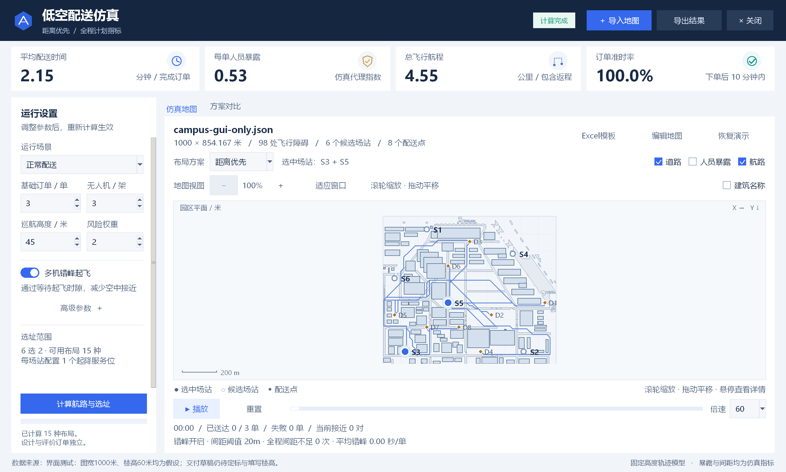

# 验证记录

## 2026年10月18日：V0.7起飞点优选与可调无人机数量

- 当前图形入口改为“起飞点优选”，数量可设置1—20架，首次打开继承主窗口数量。1架选1个位置，2—20架选2个位置并均衡分配；各布局使用相同总数与服务参数，正常/高峰冻结同一位置与分配。当前流程移除等级、预算、成本及驻机上限，历史分级实验保持独立。
- Python 3.12.14完整测试77项全部通过，耗时30.314秒：`python -X utf8 -m unittest discover -s tests -v`。新增6项测试覆盖1/3/5/8/20架真实无人机构造与均衡分配、旧等级成本字段不影响选址、设计评分最优及独立评价冻结、种子隔离、取消与越界数量、独立间距/日历/无人机资源审计、数量与位置导出。
- 真实Tk工作台验证1、3、8、20架依次修改、重算、脏状态、六组结果、对应数量的回放及主窗口参数同步、播放暂停、研究与单次导出、JSON保存再加载、普通五表Excel模板、小窗口按钮、取消及返回原三方案计算。当前界面没有预算和等级输入，也没有成本结果列；无Tk异常和错误弹窗。
- 实际默认案例 `python run.py --mode sites --drones 5 --output results/sites_v1` 完成28种布局、3个设计种子、5个独立评价种子，设计耗时15.41秒，导出30条方案评价及1350个任务。对保存结果再次独立核对各方案总数、冻结分配、起降日历、连续时间间距和导出源码/场景SHA256。
- 固定位置、距离优先、运行优选在高峰的配送时间分别为882.68、731.00、778.18秒，准时率32.33%、39.67%、39.00%。运行优选针对设计样本评分最优，独立测试中距离优先的时间和准时率更好，不能声称综合方案全面最优。所有运行完成率100%，间距事件0。
- 已检查真实默认研究结果的设置页、比较页截图，并验证默认结果可回放。操作见[起飞点优选](起飞点优选.md)。


## 2026年10月18日：V0.6分级起降场第一版

- Python 3.12.14完整测试71项全部通过，耗时22.864秒：`python -X utf8 -m unittest discover -s tests -v`。包含原有52项和新增19项设施测试，覆盖预算、驻机上限、候选点允许等级与附加成本、无解提示、站级起降服务时间、默认显式配比与旧仿真完全一致、三方案约束、设计/评价种子隔离、配置冻结、独立间距及资源审计、等待分解、P95、场地撤销重做、Excel读写及完整导出。
- 新增Excel输入检查覆盖空允许等级禁用站点、错误设施表头拒绝、等级公式拒绝；修复生成器向仅有格式的预留空行填写等级导致的无坐标记录。分级模板采用标准库生成并导入；额外使用openpyxl读取检查六张表和关键单元格，未进行Excel/WPS交互检查。
- 真实Tk窗口通过工作台入口、后台计算、六组结果、两个独立种子、正常/高峰回放、方案切换、播放暂停与进度、研究及单次导出、场地限制编辑、场景保存再加载、脏状态与取消操作。1000×720逻辑窗口候选场地控件可见；1000×680窗口导入四等级后可滚动至参数来源。计算后返回原主窗口重算恢复原有三方案名称，无Tk异常及错误弹窗。
- 原有Tk回归通过计算、切换方案、播放/暂停/进度、图层、导出、参数修改状态、错峰开关、固定场站、基线接近事件和空域关闭重算。
- 最终源码运行 `python run.py --mode facility --scene data/分级起降场示例.json --output results/facility_v1`，3个设计种子、5个独立评价种子，224种可行配置、112种不同运行配置，设计耗时56.55秒。30条方案评价、1350个配送任务的结果已保存，并独立复核冻结配置、实际成本、预算和容量、起降日历、服务时长及连续时间间距。导出时核心源码与场景SHA256与现有文件一致。
- 默认五架机、实际成本200时，高峰预算基线准时率35.67%、平均配送823.26秒，联合方案39.00%、778.18秒；正常平均配送137.15秒变为143.35秒。所有运行完成率100%，间距事件0。该案例两站均选标准级，性能变化来自选址/配比；另测8架机、预算260的可行配置必须包含增强站。结论针对本模拟数据与既有调度，不代表真实工程或滚动调度验证。
- 下图使用保存的完整默认研究结果填充真实工作台，并验证高峰联合方案可回放；完整字段与限制见[第一版文档](分级起降场第一版.md)。


## 2026年10月17日：飞行障碍与道路简图

- 新导入图片默认输出建筑外接矩形及简化道路，去掉水体、绿地、运动场和公共空地；底图保留在编辑器供定标，主地图不叠加底图及印刷文字。矩形同时用于显示和航路碰撞，属于保守障碍近似；旧无简图标记的底层多边形接口仍保持原几何能力。
- 主界面及SVG仅画建筑高度加垂直间距达到巡航高度的障碍。低楼记录保留，降低高度重算后重新参与显示和避障。名称及人员暴露图层默认关闭，缩放、平移、名称开关和悬停详情保留。
- 完整测试52项全部通过，耗时23.054秒：`python -m unittest discover -s tests -v`。涵盖矩形显示与避障一致、低楼按高度恢复、道路不阻挡飞行、保留道路大孔洞并去除细碎文字孔洞，以及定标、保存和重新应用时不重复简化道路。原有路由、调度、导入及导出测试通过。
- 真实Tk窗口30项检查通过：旧JSON转简图、只保留道路、低楼保留但不绘制、矩形角落阻挡与道路通行、所有航路分段避障、默认隐藏名称与热图、仅障碍悬停、道路可见、名称只标当前障碍、视图操作不修改结果、鼠标定点缩放、缩放按钮、左右键平移、实际飞行回放、缩放后无人机对齐、方案切换与重算保留视图、SVG简图、降低高度恢复低楼及其标签、适应窗口、98栋清华候选的无标签绘制和名称切换、原图文字不进入主图、简图阻止叠加底图、缩放上下限、小窗口控件可见、恢复演示时保留名称偏好，以及无Tk异常或错误弹窗。
- 原有桌面回归再次通过计算、切换方案、播放/暂停/进度、图层、导出、参数修改状态、错峰开关、固定场站、基线接近事件和空域关闭重算。
- 两份清华识别草稿已更新：全校394个建筑矩形候选及86个道路区域，紫荆局部98个建筑矩形候选及38个道路区域；两者仍未定标、全部楼高待填写。图例类别的底层检测抽样仍保留，用于区分建筑和地面区域，不代表整图识别准确率。
- 已检查全图与200%放大截图及1120×720逻辑窗口。截图中的图宽1000米、统一楼高60米仅为界面测试假设，未写入交付草稿。



## 2026年10月17日：主地图缩放、平移与名称开关

- 主界面新增地图视图工具栏，支持100%至1200%缩放、鼠标位置定点滚轮缩放、按钮缩放、左右键拖动平移、适应窗口与双击恢复全图。“建筑名称”开关隐藏程序叠加的名称、编号与楼高，建筑轮廓及悬停详情保留。
- 桌面交互检查通过17项：空地图操作、98个建筑标注的显示/隐藏、鼠标缩放锚点保持、缩放按钮、恢复全图、左右键拖动、回放时无人机位置对齐、布局切换保留视角、同图重算保留视角、缩放上下限、底图图片尺寸受视口限制、隐藏名称后的悬停详情、比例尺与当前缩放一致、小窗口控件可见、切换地图恢复全图、名称开关选择保留，以及通过实际两次点击验证双击恢复全图并结束拖动。
- 已检查1380×830和1120×720逻辑窗口并查看截图；底图放大后按可视区域重新采样，航路、地物、建筑和无人机使用同一坐标变换。缩放和名称开关不修改场景数据，不使结果进入“待计算”状态。
- 使用清华局部图的98个建筑进行界面回归，测试中明确假设宽度1000米、楼高30米，仅用于界面验证；交付的清华识别草稿仍保持尺度及楼高待核实。
- 原有桌面回归检查通过计算、方案切换、回放/暂停/进度、图层、导出、参数修改状态、错峰开关、固定选址、基线接近事件显示与关闭场景重算。本次仅修改界面与视图交互，未改动仿真算法；`app.py`和`ui.py`语法编译检查通过。

## 2026年10月17日：清华地图多类识别与多边形编辑

- 完整测试50项全部通过，耗时25.775秒：`python -m unittest discover -s tests -v`。本次修改模块的Python语法编译检查通过。
- 实际导入清华官网5594×7861原图及2400×2050紫荆生活区裁剪图。全校生成394个建筑候选，道路86、水体22、绿地51、运动场11、公共空地80个候选区域；局部图生成98个建筑候选，道路38、水体4、绿地19、运动场6、公共空地41个候选区域。未再按160个建筑截断。数量是分割轮廓数，不是实际对象总数或准确率。
- 参照原图人工选取17个独立位置，抽查建筑、道路、水体、绿地、运动场、公共空地及校外白纸区域，预期类别均通过。点位与依据保存在`tests/fixtures/tsinghua_landmarks.json`；此抽样不代表整图准确率。
- 合成图验证旋转建筑保留实际轮廓、橙色细铁路不成为建筑、贯穿地图的白色道路可保留、运动场草坪及白线不误当绿地或道路；印刷“排球场”文字可辅助区分共用黄色的运动场与体育建筑。
- 多边形绕障验证：三角建筑外接矩形内、实际轮廓外的位置可通行；靠近轮廓边界仍受建筑间距限制。多边形与内部空洞经过移动、调整尺寸、复制、定标及JSON保存重开保持一致；非法顶点输入不污染原数据。
- 本机Windows中文离线OCR可用。局部图116组文字候选为63个建筑候选提供名称；全校图因分析缩小后小字不清，仅为3个建筑候选提供名称。名称须人工核对，缺少OCR时仍保留轮廓识别和手动命名。
- 桌面检查通过六类图层与底图开关、多边形移动和缩放控制点、实际顶点拖动、地物类别修改、建筑/地物转换、手绘地物、保存重开、重新识别取消和撤销。实际检查1320×820及1000×680逻辑窗口，右侧滚动与底部按钮正常。像素检查确认内院空洞透明，保留下层地物；修复了Windows填充时内院被覆盖的问题。
- 实际从主程序导入全校原图并取消，原仿真结果保留；使用明确的模拟场景验证主地图地物开关及SVG的多边形/空洞导出。未将未经定标和楼高核实的清华草稿作为真实仿真验证。
- 两份可编辑识别草稿已保存到`data/真实校园地图/清华大学/`，尺度未确认、全部楼高待填、人群区为空。道路、水体、绿地和运动场分类不会自动生成人群风险或禁飞约束。

实际界面截图：[清华地图多类识别](images/tsinghua-map-recognition.png)。操作方式和识别局限：[图片地图与组件编辑](图片地图与组件编辑.md)。

## 2026年10月16日：高分屏清晰度修复

- 实机为2880×1800、192 DPI（200%缩放）。修复前进程DPI感知为0，Tk只能看到1440×900的虚拟屏幕；修复后感知为2，窗口DPI为192，原生屏幕2880×1800，主界面窗口2760×1660。未修改Windows缩放设置。
- 字体保留点数单位，布局距离和图标转换为原生像素；统一输入框与单选项字体、加深辅助文字，增大地图标注。主界面1380×830 / 1120×720、编辑器1280×840 / 1000×680均按逻辑尺寸检查。
- 实际200%显示下，主界面参数滚动、固定按钮、地图详情、方案对比和表格滚动通过；编辑器导入、手填楼高、属性修改、拖动、缩放控制点、撤销重做、保存与重算、取消回退及回放通过。
- 另在Tk中模拟100%、150%、200%的逻辑缩放，检查小窗口控件可见、图表文字边界、编辑器滚动和4倍地图缩放加平移。4倍缩放时底图在原生宽度超过5000像素的场景下仍与组件对齐，显示图片尺寸限于可视区域。
- 图片模块6项测试通过（2.340秒），包含2560×2048底图的细线保留及自包含保存、超限等比缩图、原有识别与楼高/尺度检查。本次未重新运行算法全套测试；此前40项全套结果见下方V0.5记录。

## 2026年10月16日：V0.5图片导入与组件编辑

- 完整测试共40项通过，最近一次运行耗时15.871秒。新增测试覆盖已知建筑轮廓与干扰图案的区分、手动取色、透明图片、底图自包含保存、尺度与楼高填写要求，以及组件事务、撤销重做和错误输入。
- 已验证手动楼高从10米改为70米后，固定45米巡航高度下的航路会绕开建筑，保存为JSON后重新计算结果保留修改。
- 桌面端到端检查通过图片选择、建筑拖动和控制点缩放、属性编辑、四类组件增删、批量和逐栋楼高、两点定标、草稿重开、保存及应用后重算、底图开关、取消保持原结果、回放与小窗口滚动。
- 编辑器检查了1280×840和1000×680窗口，并检查截图；主界面1380×830和1120×720的布局、计算按钮、编辑入口、对比图与表格滚动检查通过。
- 原有Excel导入、数据快照、取消与错误回退、导出一致、模板保存和恢复演示的桌面检查通过。

新功能截图：[组件编辑器](images/component-editor.png)。操作及识别范围：[图片地图与组件编辑](图片地图与组件编辑.md)。自动提取仅对建筑轮廓给出候选；楼高、尺度和真实业务点位仍需要人工填写或确认。

## 2026年10月16日：上传GitHub前检查

使用Python 3.12.14运行现有测试：

```powershell
python -m unittest discover -s tests -v
```

结果：28项测试全部通过，运行耗时13.405秒。

测试覆盖A*与独立Dijkstra代价对照、航路通行性、选址评分、评价种子独立性、任务与场站服务不重叠、连续时间间距检测、错峰和超限失败、导出一致性，以及Excel地图模板、字段错误、公式拒绝和场景快照。

## 历史界面核验

2026年10月15日已检查1380×830与1120×720两种窗口尺寸下的主要界面布局、固定计算按钮、参数滚动、地图详情、对比图和表格滚动。

此前也已核验Excel加载、取消和错误回退、地图快照、恢复演示地图，以及计算、回放、图层切换、错峰开关和导出。以上为历史桌面检查记录，本次上传前重新运行的是上面的28项模型与导入测试。

地图与对比界面截图分别保存在[地图截图](images/simulation-map.png)和[对比截图](images/plan-comparison.png)。机器相关的临时检查脚本与截图构建目录未纳入仓库。

## 现有结果与限制

已保存的模拟园区配对实验见[实验分析](../results/safety/实验分析.md)。本次仓库整理未重新生成这些实验，不改变其数据与统计口径。

MATLAB脚本尚未在MATLAB中实际运行验证。运行实验数据仍为模拟场景输入；另附清华官网导览图及未定标的识别草稿。间距检测结果仅适用于模型假设，不能解释为真实飞行验证。
