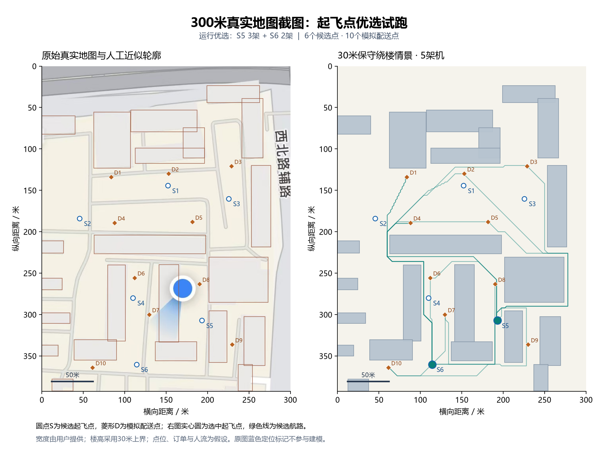
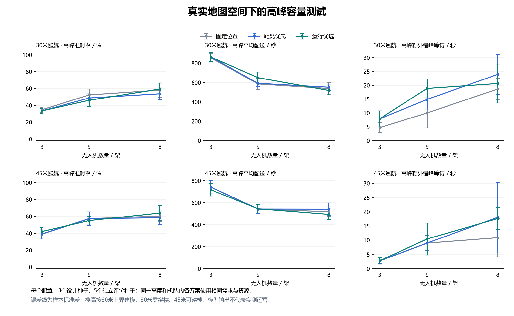

# 用户真实地图：300米宽园区试跑

底图为用户提供的真实地图截图；宽度300米、楼高不超过30米由用户提供。按等比例换算，图高约392.68米。地点名称尚未提供。

本次属于真实空间截图下的假设参数仿真，不能写成实测运营或真实飞行验证。

## 输入与模型

- 16组可见轮廓近似分成22个矩形障碍块；局部轮廓被原图定位标记遮挡，需要现场或无标记原图核对。
- 6个候选起飞点、10个配送点与3个人群热点均为试跑设置，未核实场地可用性、真实入口或人流。
- 每栋建筑按用户提供的30米上限建模；这不等于每栋实际都是30米。
- 30米巡航为保守绕楼情景；45米巡航高于楼高上限加5米垂直间距，模型中不把这些建筑视为障碍。
- 网格2米、平面间距3米、垂直间距5米；20米多机间距、9米/秒速度、25/20/20秒起飞/降落/配送服务均为模型参数。
- 正常30单/1200秒，高峰60单/800秒，600秒为准时时限。订单由模型生成；所有订单可从任一所选站发出。
- 3个设计种子与5个独立评价种子；每种数量与高度重新设计，正常/高峰冻结同一布局。各方案机队总数相同，不考虑成本。

## 独立评价均值

|巡航/米|无人机|场景|方案|起飞点与分配|准时率|配送/秒|暴露代理值|完成率|失败/次|间距事件/次|
|---:|---:|---|---|---|---:|---:|---:|---:|---:|---:|
|30|3|正常|固定位置|S1 2架 + S5 1架|100.00%|155.24|0.201|100.00%|0.00|0.00|
|30|3|正常|距离优先|S2 2架 + S4 1架|100.00%|130.72|0.208|100.00%|0.00|0.00|
|30|3|正常|运行优选|S2 2架 + S4 1架|100.00%|130.72|0.208|100.00%|0.00|0.00|
|30|3|高峰|固定位置|S1 2架 + S5 1架|34.67%|855.65|0.201|100.00%|0.00|0.00|
|30|3|高峰|距离优先|S2 2架 + S4 1架|33.33%|864.30|0.226|100.00%|0.00|0.00|
|30|3|高峰|运行优选|S2 2架 + S4 1架|33.33%|864.30|0.226|100.00%|0.00|0.00|
|30|5|正常|固定位置|S1 3架 + S5 2架|100.00%|92.83|0.189|100.00%|0.00|0.00|
|30|5|正常|距离优先|S1 3架 + S4 2架|100.00%|93.00|0.159|100.00%|0.00|0.00|
|30|5|正常|运行优选|S5 3架 + S6 2架|100.00%|109.52|0.271|100.00%|0.00|0.00|
|30|5|高峰|固定位置|S1 3架 + S5 2架|52.33%|586.11|0.202|100.00%|0.00|0.00|
|30|5|高峰|距离优先|S1 3架 + S4 2架|48.67%|592.25|0.163|100.00%|0.00|0.00|
|30|5|高峰|运行优选|S5 3架 + S6 2架|46.00%|650.52|0.267|100.00%|0.00|0.00|
|30|8|正常|固定位置|S1 4架 + S5 4架|100.00%|91.40|0.198|100.00%|0.00|0.00|
|30|8|正常|距离优先|S1 4架 + S4 4架|100.00%|88.52|0.159|100.00%|0.00|0.00|
|30|8|正常|运行优选|S3 4架 + S5 4架|100.00%|93.90|0.236|100.00%|0.00|0.00|
|30|8|高峰|固定位置|S1 4架 + S5 4架|58.00%|538.94|0.211|100.00%|0.00|0.00|
|30|8|高峰|距离优先|S1 4架 + S4 4架|53.67%|552.29|0.168|100.00%|0.00|0.00|
|30|8|高峰|运行优选|S3 4架 + S5 4架|59.33%|518.86|0.236|100.00%|0.00|0.00|
|45|3|正常|固定位置|S1 2架 + S5 1架|100.00%|108.67|0.126|100.00%|0.00|0.00|
|45|3|正常|距离优先|S1 2架 + S5 1架|100.00%|108.67|0.126|100.00%|0.00|0.00|
|45|3|正常|运行优选|S1 2架 + S4 1架|100.00%|109.50|0.126|100.00%|0.00|0.00|
|45|3|高峰|固定位置|S1 2架 + S5 1架|39.00%|742.77|0.127|100.00%|0.00|0.00|
|45|3|高峰|距离优先|S1 2架 + S5 1架|39.00%|742.77|0.127|100.00%|0.00|0.00|
|45|3|高峰|运行优选|S1 2架 + S4 1架|42.00%|718.07|0.117|100.00%|0.00|0.00|
|45|5|正常|固定位置|S1 3架 + S5 2架|100.00%|87.53|0.127|100.00%|0.00|0.00|
|45|5|正常|距离优先|S1 3架 + S5 2架|100.00%|87.53|0.127|100.00%|0.00|0.00|
|45|5|正常|运行优选|S3 3架 + S6 2架|100.00%|82.79|0.153|100.00%|0.00|0.00|
|45|5|高峰|固定位置|S1 3架 + S5 2架|57.33%|542.91|0.130|100.00%|0.00|0.00|
|45|5|高峰|距离优先|S1 3架 + S5 2架|57.33%|542.91|0.130|100.00%|0.00|0.00|
|45|5|高峰|运行优选|S3 3架 + S6 2架|55.00%|545.14|0.158|100.00%|0.00|0.00|
|45|8|正常|固定位置|S1 4架 + S5 4架|100.00%|84.53|0.126|100.00%|0.00|0.00|
|45|8|正常|距离优先|S1 4架 + S4 4架|100.00%|77.08|0.107|100.00%|0.00|0.00|
|45|8|正常|运行优选|S2 4架 + S3 4架|100.00%|83.05|0.152|100.00%|0.00|0.00|
|45|8|高峰|固定位置|S1 4架 + S5 4架|60.33%|518.39|0.134|100.00%|0.00|0.00|
|45|8|高峰|距离优先|S1 4架 + S4 4架|58.33%|541.97|0.130|100.00%|0.00|0.00|
|45|8|高峰|运行优选|S2 4架 + S3 4架|64.00%|494.50|0.159|100.00%|0.00|0.00|

## 本次发现

- 30米、5架机的高峰独立评价：运行优选准时率46.00%，固定位置52.33%；平均配送分别为650.52秒、586.11秒。该样本下运行优选没有取得时效优势。
- 45米、5架机的高峰独立评价：运行优选准时率55.00%，固定位置57.33%；平均配送分别为545.14秒、542.91秒。该样本下运行优选没有取得时效优势。
- 运行优选只保证在设计样本中按当前目标排序最优，不保证独立样本最优。选址对样本与机队数量敏感，不能用本次案例声称算法普遍优于基线。
- 8架机时运行优选的高峰均值有所改善；仅5个独立评价种子，不能据此宣称统计显著或适用于其他园区。
- 本次主要验证导入、地图表达、不同机队和高度的选址仿真及导出流程，并暴露高峰积压和选址泛化不足。





## 核验与解释

共核验8100条成功任务记录。独立复算连续间距、场站日历、无人机任务不重叠，并核验航路与建筑扩张矩形的连续线段相交。具体见 audit.json。
同一订单在不同方案和参数组中重复评价；上述任务记录数量不等于独立真实订单数量。

平均时间、暴露及P95按成功订单统计，需同时查看完成率和失败数。准时率为含失败订单的全部订单口径；表格为跨运行均值。

比较30米和45米的差异时，同时改变了障碍条件；不能把差异全部归因于选址算法。更多无人机也可能受单站服务位和空中间距约束限制。

自动导入诊断见 cases/user_map_300m/recognition_diagnostics.json：默认识别漏检且未产生足够点位，本次由取色检查与人工近似描绘完成案例，不代表自动识别已解决。

## 打开与复现

双击根目录“启动真实地图测试.cmd”查看已算好的5架机、30米保守绕楼结果；打开起飞点优选工作台可调整无人机数量与巡航高度。

也可导入 cases/user_map_300m/scene.json，或运行：

```powershell
python cases/run_user_map_case.py
python cases/run_user_map_case.py --gui
```

压缩全量研究结果保存在 studies/*.json.gz，程序可直接读取；各参数组的逐次JSON/CSV导出目录可由脚本重建。

正式参赛还需补充地点名称、地图来源与日期、无遮挡建筑轮廓、逐栋高度或楼层依据、真实候选点与配送需求依据。
