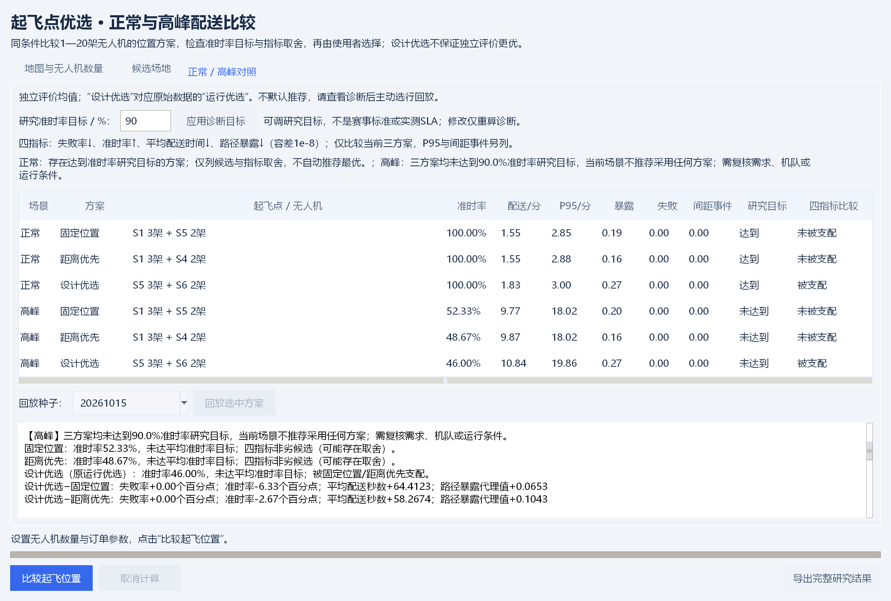

# 面向园区末端配送的低空风险仿真与起降场选址系统

中国仿真创新应用大赛｜数字建模与智能决策赛道｜智能决策方向

申请人（主持人）：

所在单位：新疆大学

联系电话：

## 作品信息表

作品名称：面向园区末端配送的低空风险仿真与起降场选址系统

所在学校：新疆大学

邮政编码：

联系人：

通讯地址：

电话：

手机：

Email：

|序号|姓名|性别|联系方式|微信|所学专业|
|---|---|---|---|---|---|
|1||||||
|2||||||
|3||||||
|4||||||
|5||||||

|指导教师序号|姓名|性别|联系方式|专业|职称|
|---|---|---|---|---|---|
|1||||||
|2||||||

### 作品内容简介

面向校园与园区末端配送，提供离线Python桌面研究原型。支持图片、Excel、JSON地图输入和组件编辑，以风险加权A*、候选位置枚举、预约错峰与连续时间间距检查比较固定位置、距离优先、设计优选三候选，支持1—20架机。V0.7第二轮增加只读诊断，展示基线差、四指标取舍、可调准时率研究目标及原设计首分歧级，取消默认推荐，由用户判断采用或暂缓。冻结布局后独立评价并保留反例、回放和完整导出；尚无真实飞行验证。

### 创新点

把可编辑地图连接位置与运行比较，再将设计词典序首分歧、独立评价反转、基线差与四指标帕累托关系显示给用户。高峰三候选未达研究目标时明确提示不推荐采用，形成输入、候选比较、人工决策与证据导出的可追溯流程。A*、帕累托及相对运动为已有方法，创新定位为可解释决策与工程集成。

### 推广应用价值

用于园区配送前期方案讨论和教学：正常样本可说明时效与暴露取舍，高峰样本可支持暂缓采用全部候选。研究目标可调，诊断不替代人工偏好，也不保证扩容有效。应用前仍需核实尺度、楼高、需求、场地和运行规则，补充动力学、能耗与实地验证。

### 项目成果

论文：是□ / 否□

专利：是□ / 否□

其他：

是否为迭代作品：是□ / 否☑

情况说明：

## 诚信承诺书

参赛成员：________________，自愿参加中国仿真创新应用大赛，为确保大赛的公平、公正、公开，维护参赛诚信和竞赛秩序，郑重承诺：

1、参赛作品（包括但不限于设计方案、作品模型、程序代码、报告文档等）均为本人（团队）独立完成，不抄袭、剽窃他人成果，不侵犯他人知识产权；若引用他人成果或公开资料，将明确标注来源并遵守相关引用规范。

2、不通过代做、买卖等非正当手段获取参赛作品，保证作品的原创性与创新性。

3、严格遵守大赛章程及组委会的各项规定，服从赛事安排和管理；不参与任何形式的作弊、串通评审或其他有损竞赛公平的行为。

4、如若提交作品为往届迭代作品，确保作品更新至少30%的内容，且在作品信息表中说明迭代部分并提供证明材料。

如违反上述承诺，本人（团队）自愿接受大赛组委会的处理，包括但不限于取消参赛资格、收回奖项、通报批评等，并承担由此引发的一切法律责任。

             团队成员（签字）：

                    年       月       日

（注意事项：签字部分需为手写，扫描后上传pdf版本；团队参赛需所有成员签字；承诺书需与参赛作品一并提交；请务必如实填写。）

## 摘要

园区无人机配送需要在候选位置、送达时效与人员路径暴露之间作出选择。本作品提供离线Python桌面研究原型，将可编辑地图、风险加权航路、两场站组合设计与预约错峰连接为可追溯流程。V0.7第二轮增加只读决策诊断：逐场景展示基线差、四指标帕累托关系、可调准时率研究目标和设计目标首分歧级，取消默认方案推荐，由用户依据证据判断采用、取舍或暂缓。

系统主体使用Python实现，采用Tkinter提供桌面交互。地图支持图片、Excel和JSON输入；图片只提取建筑候选，用户确认米制尺度并手动填写楼高，随后可在程序内增删、移动和调整四类组件。模型使用八邻域A*搜索风险加权航路，以独立设计订单枚举和评价两个场站的组合；运行阶段选择最早可送达的无人机，并通过连续时间相对运动计算检查间距，必要时推迟起飞。

当前位置设计仍按3个设计种子的正常与高峰样本等权比较28种布局，冻结5架机及3+2分配。旧5种子评价中，设计优选正常配送143.35秒、暴露0.797，距离优先123.71秒、1.093，形成时效与暴露取舍；高峰设计优选778.18秒、准时率39.00%，三方案均达不到本轮默认90%准时率研究目标。第二轮在协议冻结后追加20261040—20261059新种子，以两张既有地图240条评价检查诊断，不改变模型和位置，也不混算原5种子与此前20种子。历史700次降至0次和增加35.53秒仅属于旧调度配对。

全部结果来自明确设定的模拟输入。人员暴露是相对代理指标，间距结论只适用于固定高度、匀速折线及悬停模型；本作品尚未完成真实飞行验证。现阶段成果适合方案比较和模型教学，可作为接入经核实园区数据的基础。

关键词：低空配送；风险加权A*；起降场选址；连续时间间距检测；错峰调度；可编辑地图

## 1 引言

本作品面向校园或园区内的小范围末端配送，研究“选择哪两个候选场站、沿什么航路配送、何时安排各架无人机出发”三个相互影响的问题。项目不把三维画面复杂度作为研究目标，而以可解释的模型、可操作的地图和可复核的对照实验支撑决策。

针对使用者难以整理坐标文件的问题，系统允许直接导入地图图片，再确认尺度和楼高；针对场站位置改变后需要重做航路的问题，系统把地图转换成统一场景对象，自动更新障碍和风险；针对多机只做动画而不检查接近的问题，系统独立审计完整任务航迹，并记录接近时间、最小间距和涉及订单。

报告依次说明需求与范围、数据组织、算法与系统实现、配对实验和应用流程。算法部分采用标准A*思想[1]，本作品的主要工作在于模型组合、编辑交互、预约约束和证据导出。对“最优”的表述限定在给定离散图或有限候选集合内，不声称获得真实城市三维空域的全局最优解。

## 2 研究背景及意义

### 2.1 实际问题与评价目标

校园和园区配送具有服务范围相对集中、建筑密集、人员活动区域差异明显的特点。无人机可以缩短部分地面绕行，但直线飞行可能穿过高建筑投影或人群活动区域；候选起降场的距离优势，也可能被返航、起降排队和机队分配抵消。因此需要同时报告时间、航程、路径暴露、准时率、完成率及间距不足事件。

民用无人机优化研究涉及任务分配、航路、设施和作业约束，Otto等[2]对此进行了综述。Murray和Chu[3]研究卡车与无人机协同配送，Dorling等[4]研究无人机配送路径问题；Kong等[5]进一步按协同程度梳理相关模型。本作品选择固定场站服务园区的场景，将车辆协同、补能和多点串行配送留在研究范围之外，以便集中检验选址、路径暴露与错峰之间的关系。

本作品检验两个层级的问题：当前V0.7在正常与高峰共同设计下，固定位置、距离优先、设计优选形成怎样的时效与暴露权衡；历史安全配对实验在相同订单、位置和航路下，错峰如何改变间距事件与等待。当前位置评价冻结正常与高峰的同一布局；历史关闭场景则按场景重新选址，两者证据范围不同。

### 2.2 研究范围与假设

研究空间为本地米制平面，建筑附带高度属性，航路在一个给定巡航高度上搜索。该表示属于带建筑高度约束的二维规划，不包含连续三维机动。无人机按恒定速度沿折线飞行，配送处理和返场排队可发生悬停；每架无人机固定归属一个场站，每个场站只有一个共享起降服务位，任务完成返场服务后才能执行下一单。

建筑高度、尺度、候选场站和人群热点属于输入条件。图片中的楼高不能可靠推断，必须手动录入；人群热点权重为研究设定，没有用未经采集的真实人数代替。20米空中间距、8米建筑平面间距与5米垂直间距均为模型参数，不能直接用作监管或运营标准。

### 2.3 应用价值与证据要求

系统服务于园区前期方案讨论：用户导入并核实地图后，比较三种候选的时效、路径暴露及服务目标。正常样本中的取舍可以帮助用户表达偏好；高峰三方案均未达目标时，系统明确提示当前场景不推荐采用任何方案。诊断不把“优选”名称当作结论，也不把未达标解释成已找到容量扩充办法；下一步干预仍需控制实验。

## 3 研究内容与方案

### 3.1 系统结构与数据流程

系统将交互、核心计算和只读诊断分离。地图编辑器形成统一场景；核心引擎建立航路、设计位置并预约任务；间距模块独立审计分段航迹；第二轮decision_support.py读取冻结评价，计算相对固定位置及距离优先的差值、四指标帕累托关系、准时率目标状态与设计目标首分歧级。用户依据这些信息选择候选或暂缓，导出诊断及原始任务证据。诊断不修改A*、位置设计、目标函数或调度。图1为核心计算流程，3.10B说明其后的诊断。


图1 从地图输入到可复核结果的系统流程

地图一经成功导入便保存为内存快照。磁盘文件被改动不会悄悄改变已计算结果；重新导入或应用编辑后才生成新场景。参数发生修改时，界面提示重新计算，再允许按新结果回放和导出。模型错误和输入错误均保留原场景，避免半完成的编辑污染当前结果。

### 3.2 场景对象与数据来源

统一场景包含地图宽高、网格步长、建筑、候选起降场、配送点、人群风险区及数据来源说明。坐标原点位于地图左上角，X向右、Y向下，平面坐标和建筑高度单位均为米。建筑以轴对齐矩形近似，允许多个矩形描述复杂建筑；目前未采用精确多边形或倾斜建筑模型。

表1 核心场景字段及其作用

|对象|主要字段|模型用途|
|---|---|---|
|地图设置|宽、高、步长、来源|统一米制尺度和离散范围|
|建筑|编号、位置、长宽、高度|判断固定高度下的障碍|
|候选场站|编号、名称、坐标|枚举两个场站的组合|
|配送点|编号、坐标、需求权重|订单目的地及抽样权重|
|人群区|中心、椭圆半径、权重|形成相对暴露风险场|

当前V0.7与历史安全实验均以项目自建960×640米模拟园区为基础，含10栋建筑、8个候选位置、10个配送点、4个人群热点。当前选址使用results/sites_v1/scene.json，历史配对使用data/demo_scene.json及results/safety/manifest.json记录的场景；来源、处理后的场景和校验值分开保存。建筑名称、楼高、人群和需求均为模拟设定，不能视为真实调查。清华大学官网导览图仅用于真实图源接入与识别草稿，尺度、楼高、需求尚待核实，未纳入定量效果。

实验输入和结果的完整性以文件校验值记录于附录。数据说明同时保留“模拟、估计或核实”的来源要求：当前数据属于模拟；未来导入实际园区时，应逐项记录图源、获取日期、尺度依据、楼高依据、人工修正记录和需求估计口径。仅更换一张底图，不等于建立了经核实的真实案例。

### 3.3 图片导入与可编辑组件

图片与编辑显示使用可选Pillow。清华官网导览图的图例分类与轮廓处理另使用NumPy、OpenCV，Windows离线OCR可产生名称候选。通用模式依颜色和连通区域产生建筑候选，适合颜色相对规整的平面地图；复杂卫星图、阴影、树冠和倾斜建筑可能误检或漏检。当前没有建立识别准确率数据集。核心仿真和Excel/JSON导入使用Python标准库，不依赖这些图像包。

导入后必须确认整图宽度或通过两点已知距离定标。若已知实长为L、对应像素距离为d，则比例s=L/d；平面位置和尺寸按该比例转换。建筑高度独立于平面比例，缩放地图不修改楼高。用户逐栋或批量填写楼高；未确认尺度、仍有未填写高度时，程序阻止直接仿真并提示待补项目。


图2 地图组件编辑器与手动属性录入界面  模拟园区

建筑、起降场、配送点和人群区均为独立组件，可在程序内增删、复制、拖动和编辑；道路轮廓可编辑并概括显示，但不作为无人机通行障碍。编辑支持撤销、重做、草稿保存和重开，JSON可嵌入底图。主仿真图使用与规划一致的建筑矩形简图，只把当前高度下构成障碍的建筑显示为障碍；原图保留供人工核对。自动建议点位仍需人工确认。

为改善放大时的可读性，底图最长边保留至3072像素并使用高质量重采样；大幅缩放时只裁切和绘制可视区域。Windows端启用原生高DPI感知，文字和控件按系统缩放显示。底图分辨率只影响显示，建筑几何与航路仍由米制组件数据计算。

### 3.4 建筑约束与人员暴露风险场

对巡航高度H和建筑高度h，若h+Δh≥H，则建筑成为该高度下的障碍，并在平面矩形外扩Δxy。本实验H=45米、Δh=5米、Δxy=8米。已知高度可以允许从较低建筑上方通行，但由于没有爬升下降过程，该结果只能用于给定高度平面的比较。固定关闭区在整次仿真中不可通行。

阻塞条件：h + Δh ≥ H；平面障碍为建筑矩形向外扩展 Δxy。

Primatesta等分别研究了城市环境中的无人机地面风险地图[6]与风险感知航路规划[7]，为在空间规划中显式考虑风险提供了研究依据。本作品以可编辑人员热点构造简化暴露场，用于比较航路；尚未复现文献中的完整地面风险模型，热点权重也未经过实际数据标定。

人员暴露场以基础值和椭圆高斯热点叠加构成，超过1时截断。热点的中心、椭圆半径及权重均可编辑。风险值表示路径经过该位置的相对地面人员暴露强度，不表示事故概率，也没有包含飞行器失效概率、坠落扩散和伤害后果。

r(x,y) = min{1, 0.035 + Σk wk exp[-2((x-xk)²/rxk² + (y-yk)²/ryk²)]}  （1）

路径暴露使用路段长度乘中点风险值的离散积分。由于任务沿去程原路返航，每单路径暴露指数为往返积分除以100；除数只是显示尺度。配送悬停和返场悬停虽然纳入间距检测，尚未计入该暴露指数。因此需要把它理解为“飞行路径暴露”，不能据此判断全部任务的总风险。

Rpath = Σe le r(me)；Eorder = 2Rpath / 100。  （2）

### 3.5 风险加权A星航路规划

程序以默认16米步长建立八邻域栅格。阻塞节点不可通行，对角移动禁止穿越阻塞拐角；线段连接还以不超过3米的间隔检查通行条件。起点和终点在邻近5×5栅格范围内选择最近可接入节点，并保留实际端点到节点的连接线。窄通道可能被栅格遗漏，连接采样也不构成精确CAD碰撞证明。

每条邻接边的代价由距离和暴露共同决定，其中λ为非负风险权重，本实验λ=2。启发函数使用到目标接入节点的欧氏距离。由于边代价不小于几何距离，该启发函数是下界；在当前图、已选接入节点和约束内，A*搜索得到最小加权代价的离散航路。标准算法依据见文献[1]。

c(u,v) = ||u-v|| [1 + λ r((u+v)/2)]。  （3）

f(n) = g(n) + h(n)；h(n) = ||n-goal||。  （4）

航路库为每个候选场站到各配送点预先计算路径并缓存距离、暴露与累计长度。改变地图、巡航高度或风险权重后重新建立航路库；改变订单种子时可以沿用同一规划条件下的航路。所有场站方案使用同一风险加权规划器，“距离优先方案”指场站评分以总航程为目标，不代表该方案另外使用了λ=0的最短距离航路。

本作品将算法核验和业务结果区分。小型构造场景中，测试使用独立Dijkstra搜索[8]计算同一图的目标代价，与A*输出对照至数值精度；另行检查端点、累计长度和每段通行性。该证据支持实现一致性，不能扩大为连续空间或任意地图上的精度认证。

### 3.6 当前V0.7起飞位置设计

系统在可用候选位置中枚举组合。1架无人机使用1个起飞点，2—20架使用2个起飞点；各布局总机队相同，按候选点顺序均衡分配，奇数时前站多一架。当前证据为5架与8候选点，共28种布局。所有站点采用相同起降服务参数，设施等级、建设成本及预算不参与当前流程。

设计种子为20365744、20470473、20575202。每个组合使用各设计种子的正常与高峰订单并开启相同错峰约束，正常与高峰等权。固定位置优先S1、S5，不可用时按可用顺序补足；距离优先先比较正常设计样本失败数，再比较总航程。设计优选依次最小化平均失败率、平均非准时率、平均每单超时秒数、平均配送秒数加30倍路径暴露，同分按站点编号确定。30为人为权衡系数，尚未通过业务偏好校准。

J运行 = lexmin (失败率, 1-准时率, 每单超时秒数, 配送秒数 + 30×路径暴露)。

词典序比较先保证前项不劣，再考察后项。有限枚举只保证在给定候选、3个设计种子及设定目标下取最小值，不保证独立评价、连续选址或真实运营的全局最优。选址阶段纳入预约式错峰，但运行调度仍按订单顺序贪心预约，没有滚动重优化。

当前位置方案为固定S1+S5、距离S3+S7、设计优选S6+S8，各为前站3架、后站2架。正常与高峰独立评价冻结同一位置和配比，设计种子与5个评价种子分离。无人机数量变化后必须重新选址。

历史safety实验使用engine.evaluate_plans的旧流程：每个场景单设计种子20365744，先用基线调度选址，综合风险采用暴露、时间、航程、场站等待的min-max归一化加权（0.45、0.30、0.15、0.10）及失败惩罚。它与当前site_selection.py的跨场景词典序设计不同，仅作为历史调度对照，不能用其正常S2+S6或137.15秒替代当前S6+S8和143.35秒。

### 3.7 订单生成与场站资源预约

订单生成使用可复现伪随机数，根据配送点需求权重抽取目的地，再生成订单创建时刻。正常和关闭场景为30单、到达窗口1200秒；高峰为60单、到达窗口800秒。到达时间为均匀随机数映射并取整，不将其描述为经过数据拟合的泊松过程。默认订单从创建起600秒内完成配送为准时。

5架无人机按顺序归属两个选定场站，通常形成3架与2架的配置。订单按创建时刻、编号依次处理；每个候选无人机需同时满足空闲、场站起飞服务可用、航路可达等条件。程序先计算最早起飞准备时隙，完成25秒准备后出发，以9米/秒飞向目的地，处理20秒后返航，返场占用20秒降落服务。每个场站的起飞和降落共用一份日历。

在可行候选中选择最早送达者，同分按无人机编号确定。日历一经预约不被后续订单调整，属于按订单顺序的贪心预约，并不保证全局最短等待。平均配送时间包含等待无人机、场站排队、错峰、去程和配送处理；订单送达后返航和降落不再计入该单配送时间，但会影响后续任务可用时刻。

### 3.8 连续时间间距检测与错峰

每次配送任务的空中部分拆分为去程折线、目的地悬停、返程折线和必要的返场悬停。起飞准备和降落服务视为地面阶段，不参与当前空中间距判断。两架无人机在重叠时间区间内的相对位置为r+vτ，求解二次不等式即可得到距离严格小于阈值的时间区间，不依赖逐秒采样。基于预测航迹检查间距属于冲突检测问题，相关建模方法的综述可参见Kuchar和Yang[10]。

||r + vτ||² < dmin²。  （8）

检测输出接近开始与结束时刻、最接近时刻、最小距离及对应订单。对同一任务对跨越航路折点但时间连续的片段进行合并，计为一次事件。冲突累计时长是每个任务对接近时长之和，同一时刻若有多对接近会分别累计。本文使用“间距不足事件”表示上述模型判据，不把它等同于真实碰撞。

启用错峰后，对每架候选无人机，先按场站日历确定基准准备时隙，再检查完整候选任务与已接受空中预约。发现接近时按5秒步长推迟请求时刻，并重新计算场站服务及返场等待；最大额外推迟为600秒。选择最早可送达的可行任务；全部候选都超限时记录airspace_delay_limit失败，无航路时记录unreachable失败。

场站等待定义为原起飞排队与返场排队之和，错峰等待单列为相对基准准备时隙的额外推迟。由于推迟还会影响后续任务可用时间，平均配送时间的增量通常大于单列错峰等待。整个排程完成后，程序再次独立检测所有航迹，包括基线调度，以防仅因调度分支未检查而漏报。

该方法只调整任务出发时刻，不改变已接受预约，也没有在飞行途中进行避碰控制或突发重规划。5秒离散搜索和600秒上限可能拒绝实际存在其他解的订单；模型内零间距不足不代表真实航空安全保证。

在动态环境规划方面，Phillips和Likhachev[11]提出以安全时间区间组织搜索的SIPP；Sharon等[12]提出面向多智能体路径规划的冲突搜索方法。两者为后续时空规划提供了参照。本作品使用既定航路和顺序预约，仅搜索出发时刻，未实现SIPP或CBS，也未获得这些方法所研究的多智能体最优性保证。

### 3.9 桌面界面与结果导出


图3 默认园区原5种子诊断  达标候选与指标取舍

第二轮工作台不默认选中候选，回放需主动选行，导出全研究及三方案诊断无需选行。修改研究目标仅更新诊断，须应用目标后再回放或导出。图3为默认园区原5评价种子的正常例，设计优选与距离优先在时间和暴露上存在取舍；图4为含假设截图示例的同一批5种子高峰，设计优选被两基线支配，三候选均未达90%研究目标。图4对固定位置配送增加64.41秒，不与此前20种子的42.34秒混用。两图使用原5种子，3.10B才使用本轮新增20种子。



图4 截图示例原5种子诊断  被支配与目标未达

完整JSON保存场景、参数、种子、候选评分、航路、订单、任务、服务日历和冲突事件；CSV便于核对指标、任务和失败类型，SVG便于放大查看地图及对比图。批量实验另行输出原始运行表、配对差值表、汇总表和清单。MATLAB脚本可作为后续绘图入口，本机尚未实际运行，不把它列为已验证的软件联动成果。

### 3.10 当前V0.7独立评价

结果来自results/sites_v1。评价种子20261015—20261019与3个设计种子互不重复，同一种子同一场景的三个方案共享订单。2场景×5种子×3方案共30条评价记录；每种场景与方案报告5次运行等权均值和样本标准差，不能视为置信区间或真实飞行样本。P95为每次运行成功订单最近秩P95的跨运行均值。

表2 当前V0.7正常与高峰评价

|场景与方案|位置及机队|配送秒数<br>均值±标准差|路径暴露<br>均值±标准差|准时率|
|---|---|---|---|---|
|正常<br>固定位置|S1 3架<br>S5 2架|166.12 ± 23.89|0.928 ± 0.085|100.00%|
|正常<br>距离优先|S3 3架<br>S7 2架|123.71 ± 18.95|1.093 ± 0.107|100.00%|
|正常<br>设计优选|S6 3架<br>S8 2架|143.35 ± 16.92|0.797 ± 0.092|100.00%|
|高峰<br>固定位置|S1 3架<br>S5 2架|882.68 ± 38.81|0.957 ± 0.073|32.33%|
|高峰<br>距离优先|S3 3架<br>S7 2架|731.00 ± 40.00|1.180 ± 0.093|39.67%|
|高峰<br>设计优选|S6 3架<br>S8 2架|778.18 ± 43.11|0.865 ± 0.113|39.00%|

全部30条当前评价记录均完成所有订单，失败数和间距不足事件为0；这只支持当前理想模型和给定样本。正常设计优选相对距离优先的暴露降低27.1%，配送时间增加19.64秒。高峰暴露降低26.6%，但配送时间增加47.18秒、准时率低0.67个百分点。独立评价没有复制设计阶段对早期目标的排序优势，不能声称设计优选在高峰时效上优于距离优先。

原5种子高峰设计优选平均778.18秒、准时率39.00%，多数订单超过600秒。本批结果不满足本轮默认90%平均准时率研究目标，提示进一步检验需求与资源条件；没有控制干预实验，不能据此归因于唯一容量瓶颈，或保证调整位置、时隙及机队必然达标。5个评价种子仅构成有限初步证据。

### 3.10A 冻结布局追加种子检验

为检验结论是否依赖原5个评价种子，本轮冻结既有布局和参数，不重新设计或调参，对默认模拟园区与既有真实截图示例两张地图，各使用20261020—20261039共20个新增订单种子，分别运行正常和高峰。2地图×2场景×20种子×3方案共240条新增方案运行、10800条重复评价任务记录。这是同两张既有地图的新订单样本，不能称为新增实测园区或真实订单。

表3 新增20种子高峰差值及逐指标优平劣

|地图与基线|指标|设计优选减基线<br>均值 ± 样本SD|优/平/劣|
|---|---|---|---|
|默认园区<br>距离优先|准时率百分点|-4.17 ± 3.65|0 / 2 / 18|
|默认园区<br>距离优先|配送秒数|+88.63 ± 54.43|1 / 0 / 19|
|默认园区<br>距离优先|路径暴露|-0.335 ± 0.109|20 / 0 / 0|
|截图示例<br>固定位置|准时率百分点|-1.83 ± 4.92|7 / 0 / 13|
|截图示例<br>固定位置|配送秒数|+42.34 ± 39.84|3 / 0 / 17|
|截图示例<br>固定位置|路径暴露|+0.064 ± 0.018|0 / 0 / 20|

原5种子截图示例高峰设计优选650.52秒、准时率46.00%，固定位置586.11秒、52.33%，来源为results/user_map_300m/测试报告.md。追加20种子中，默认高峰相对固定位置，设计优选准时率平均增加3.00个百分点、16优1平3劣；相对距离优先却平均降低4.17个百分点，配送更慢88.63秒。截图示例高峰相对固定位置，设计优选配送更慢42.34秒，路径暴露20次均劣。新增样本进一步显示方案依赖地图与目标，不能用单一总胜率或“普遍优于距离方案”概括。这里没有进行统计显著性检验，样本标准差也不是置信区间。

截图示例采用既有30米巡航高度和5架机，底图来自实际地图截图，但尺度、楼高、需求及人群包含假设；其空间边界不同于清华官网未定标草稿，不能混称真实校园验证。源研究、场景、源码与结果哈希见results/competition_v07/manifest.json。原始差值、范围和7项指标的逐项优平劣均保存；复现命令为python cases/run_competition_holdout.py --output results/competition_v07_reproduction。

独立轨迹核查从导出的路线点和任务时刻重建分段运动，不调用生产间距检测器，并检查机队任务及服务日历。空中/地面切换同一瞬间的零时长交接在现有模型中不计持续间距事件，已有33个同站交接记录，不能解释为真实起降安全；详见技术验证文档。

### 3.10B 第二轮决策诊断与新种子检查

第二轮仅增强结果解释。“设计优选（原运行优选）”表示原设计样本词典序选择的候选，历史raw文件仍保留plan=combined及旧名称；名称不保证独立评价占优。输入、三候选、取舍或拒绝、人工决策、证据导出构成当前使用流程。算法、位置、机队、原目标与调度均未因新诊断而改变。

服务准时率默认90%，是团队设置、用户可调的研究目标，不是赛事通过线、法规或运营承诺。按每场景跨运行等权平均准时率判断，不保证每个种子或每笔订单达标。三方案均未达该目标时，提示当前场景不推荐采用任何方案；有达标方案时也只列候选，不自动推荐。每笔订单准时仍指创建后600秒内送达，两种阈值含义不同。

帕累托比较只考虑本次三候选的失败率降低、准时率提高、平均配送秒数降低和路径暴露降低四个方向。失败率先逐运行计算失败数/订单数，再跨运行等权；配送和暴露按成功订单统计。用1e-8容差判断各轴不劣且至少一轴更优为支配；任一观测缺失则对应指标待验证，四指标关系整体待验证。非劣不意味着全部28种布局或真实世界最优。

设计目标解释沿用原精确浮点词典序，依次为失败率、非准时率、每单超时秒数、配送秒数+30×暴露；显示与两基线的首分歧层，并对容差内差异提示近似平局。默认园区对固定位置精确首分歧为第2层、首实质分歧为第2层；默认园区对距离优先精确首分歧为第2层、首实质分歧为第2层；截图示例对固定位置精确首分歧为第2层、首实质分歧为第2层；截图示例对距离优先精确首分歧为第2层、首实质分歧为第2层。本次第二层若已决定排序，第四层系数30并未参与最后区分；不能把该次选择归因为低暴露偏好。设计/评价反转只是样本差异描述，尚无因果证明。

协议docs/参赛验收/第二轮实验协议.json在新评价前冻结。两张既有地图均保留5架机和已有位置、分配、模型参数，只追加20261040—20261059共20个未用订单种子。2地图×2场景×20种子×3候选形成240条新方案评价；新旧种子不混算，不根据结果重新设计或调参。完整研究、诊断JSON/CSV/Markdown、原始差值、独立审计与哈希保存在results/decision_v07_round2/。

表4 第二轮新种子中的设计优选诊断

|地图与场景|平均准时率|90%研究目标|四指标关系|
|---|---|---|---|
|默认模拟园区<br>正常|100.00%|达到|四指标非劣|
|默认模拟园区<br>高峰|38.08%|未达到|四指标非劣|
|截图假设示例<br>正常|100.00%|达到|被支配|
|截图假设示例<br>高峰|47.08%|未达到|被支配|

正常例：默认园区相对距离优先，设计优选平均配送差+30.77秒、路径暴露差-0.285、准时率差+0.00个百分点。该例用于说明用户可见的指标取舍，不把非劣关系自动转换成推荐。

反例：截图假设示例高峰相对固定位置，设计优选配送差+51.32秒、路径暴露差+0.062、准时率差-4.33个百分点。系统逐轴保存这些差值，并依据完整四指标报告关系；三方案均未达到90.0%准时率研究目标，当前场景不推荐采用任何方案；需复核需求、机队或运行条件。 不能据此宣称已识别超时的唯一原因或证明增加机队一定有效。

旧样本高峰设计优选等待无人机655.17秒、额外错峰12.42秒/成功单，可提示优先检验任务周转及资源等待，而不是直接放宽间距。等待无人机包含前序任务各阶段传导；返场排队影响后续任务，不能重复加进本单送达分解。当前诊断没有执行扩容或服务能力干预，因此“容量问题”仍是待控制实验检验的解释。

另对原设计样本做留一稳定性检查：两地图共43种布局×3设计种子×2场景形成258条布局运行，保留全部3种子及3次留一子集的172条候选得分。默认园区3次留一中有2次改变所选位置；截图示例3次留一中有2次改变所选位置。完整结果见design_stability.json、design_subset_candidate_scores.csv及design_seed_stats.csv。该检查属于样本内选择敏感性，不是新增外部验证；没有用留一结果替换旧布局，也不能据此证明稳定泛化。

留一还暴露原精确浮点排序的边界：默认园区去掉设计种子20470473时，S4+S7与原S6+S8第二层仅差-5.55×10⁻¹⁷，精确排序选择S4+S7；跳过1e-8内近似平局后，首实质差在第3层每单超时，S4+S7反而增加0.9884秒。因此两种首分歧分别保留，极小差不解释成实质收益。第二轮没有据此修订原排序或替换旧布局；实际采用前仍需另定稳健设计方案并使用新的评价数据。

### 3.11 历史安全配对实验设计

采用3种场景×5个评价种子×3种布局×2种调度的完整方案组合，得到90条运行指标和45组配对比较。每个场景先使用设计种子选址一次，随后在评价种子20261015至20261019上复用布局。种子只是随机流标识，不是实测日期。每一组比较使用相同订单、航路、布局、无人机数量和服务参数，仅改变错峰开关。

表5 仿真主要参数

|参数|设定|说明|
|---|---|---|
|模拟园区|960×640米|10栋建筑，8候选场站，10配送点|
|巡航与栅格|45米；16米|固定高度，八邻域|
|建筑间距|平面8米；垂直5米|研究参数|
|风险权重|λ=2|所有布局共用|
|机队与速度|5架；9米/秒|场站固定归属|
|服务时间|起飞25秒；降落20秒；配送20秒|每场站一个服务位|
|准时阈值|下单后600秒|含等待与配送处理|
|错峰参数|间距20米；步长5秒；上限600秒|研究设定，非监管标准|
|订单负荷|正常30单/1200秒；高峰60单/800秒|模拟随机到达|
|关闭区域|(470,200)，宽75，高150米|整次运行生效，按地图比例缩放|

关闭场景中，关闭矩形在建图前设置，并在设计和评价全过程生效。每种场景分别重新选址，因此这里比较的是在各自已知条件下设计的方案，不能用来证明同一布局对途中突发关闭的鲁棒性。

平均配送时间和平均暴露以成功订单为分母；完成率与准时率以全部订单为分母，失败订单计为未完成和未准时。报告同时检查失败数，以避免只在成功子集上获得好看的均值。90条指标是方案评价记录，不是90次真实飞行；相同订单流在不同方案中重复评价，合计事件和完成次数不代表独立业务量。

完成率 = N成功/N总；准时率 = N按时送达/N总。  （9）

平均配送时间 = Σ成功订单(t送达-t创建)/N成功。  （10）

汇总表对同一场景、布局和调度的5个评价种子计算均值及样本标准差。误差线为样本标准差，不是置信区间；5个种子只提供初步稳定性证据，不据此声称统计显著或普遍有效。

### 3.12 历史安全配对结果

保存的45组配对结果中，基线间距不足事件合计700次，错峰为0次；两种调度均无失败订单，完成率均为100%。按45组运行的平均配送时间差值等权计算，错峰增加35.53秒，该值不按订单数加权。表6给出历史全部布局的间距事件和配送时间，图5、图6展示综合风险布局的变化。

表6 历史 五个评价种子的间距事件与配送时间

|场景与布局|间距不足事件<br>基线→错峰 / 次|平均配送时间<br>基线→错峰 / 秒|
|---|---|---|
|正常配送<br>固定布局|10.00 ± 2.92 → 0|138.17 → 166.12|
|正常配送<br>距离优先|10.40 ± 3.51 → 0|103.21 → 123.71|
|正常配送<br>综合风险|9.20 ± 4.27 → 0|120.43 → 137.15|
|高峰订单<br>固定布局|26.20 ± 6.38 → 0|799.19 → 882.68|
|高峰订单<br>距离优先|27.20 ± 2.49 → 0|720.31 → 778.18|
|高峰订单<br>综合风险|27.20 ± 2.49 → 0|720.31 → 778.18|
|局部空域关闭<br>固定布局|9.80 ± 2.86 → 0|138.17 → 159.94|
|局部空域关闭<br>距离优先|10.60 ± 3.78 → 0|114.67 → 133.18|
|局部空域关闭<br>综合风险|9.40 ± 4.04 → 0|120.51 → 135.58|

表6间距事件给出基线均值±样本标准差；错峰9种组合均为0±0次。配送时间栏为跨种子均值。完整的时间与其他指标标准差见附录所列summary.csv，避免仅凭表中均值判断稳定性。


图5 综合风险布局的间距不足事件  均值与样本标准差


图6 综合风险布局的平均配送时间  均值与样本标准差

表7 历史 人员路径暴露 错峰等待与准时率

|场景与布局|暴露指数<br>基线→错峰|错峰等待<br>秒/单|准时率<br>基线→错峰 / %|
|---|---|---|---|
|正常配送<br>固定布局|0.884 → 0.928|5.97|100.0 → 100.0|
|正常配送<br>距离优先|0.998 → 1.093|3.17|100.0 → 100.0|
|正常配送<br>综合风险|0.847 → 0.849|2.92|100.0 → 100.0|
|高峰订单<br>固定布局|0.983 → 0.957|13.11|36.3 → 32.3|
|高峰订单<br>距离优先|0.881 → 0.865|12.42|39.3 → 39.0|
|高峰订单<br>综合风险|0.881 → 0.865|12.42|39.3 → 39.0|
|局部空域关闭<br>固定布局|0.896 → 0.931|4.73|100.0 → 100.0|
|局部空域关闭<br>距离优先|1.122 → 1.150|5.29|100.0 → 100.0|
|局部空域关闭<br>综合风险|0.885 → 0.846|3.31|100.0 → 100.0|

表7各值均为5个评价种子的均值。所有组合完成率均为100%、失败数均为0；准时率反映完成时间而非能否最终完成。暴露指数没有纳入悬停，不能把错峰后指数下降解释为全部任务风险降低。


图7 综合风险布局的每单路径暴露指数  均值与样本标准差

### 3.13 历史结果的适用范围

正常场景下，固定、距离优先和综合风险布局分别选中S1+S5、S3+S7和S2+S6。错峰后距离优先的平均配送时间为123.71秒、每单暴露1.093；综合风险为137.15秒、暴露0.849。综合方案的暴露均值相对距离方案降低约22.3%，同时配送时间增加13.44秒，体现当前权重下对人员活动区域的回避代价。该相对差异只针对所设地图和需求。

高峰场景中，距离优先与综合风险均选中S6+S8，因此两者结果相同。错峰后平均配送时间778.18秒，准时率39.0%；固定布局为882.68秒和32.3%。虽然所有订单最终完成，运行仍不满足大部分订单600秒内送达的时效目标。可优先研究增加机队、调整站点归属和服务能力，而不是通过放宽间距来掩盖拥堵。

关闭场景中，综合风险布局错峰后的平均配送时间135.58秒、暴露0.846；距离优先为133.18秒、暴露1.150。两者时效接近，但路径暴露差异明显，说明在本场景下仅按航程选址会遗漏人群分布。由于每个场景重新设计站点，这仍不是对同一站点组合的突发事件应对验证。

错峰可能使无人机选择发生变化，而各机固定归属的场站不同，因而总体航程与暴露也可能变化；不能假设“只推迟时间”就一定使全部路径指标保持不变。另一方面，暴露没有覆盖悬停，现有指标不足以计算等待带来的完整风险和能耗代价。

### 3.14 软件验证与可复现性

2026年10月17日41项和10月18日80项测试均为前轮记录。第二轮新增14项诊断校验后，完整94项测试实际通过，耗时35.930秒，原日志为.verification/competition_20261018/full_tests_decision_round2.txt，交付副本见docs/参赛验收/第二轮证据/。冻结原指标对照、独立诊断审计及Tk检查详见本轮技术验证记录与results/decision_v07_round2/manifest.json。测试只支持实现与设定模型一致，不替代真实数据、识别准确率或飞行验证。

表8 已执行的关键核验

|核验对象|核验方式|结果与边界|
|---|---|---|
|航路正确性|与独立Dijkstra代价对照；端点与通行性检查|通过；限当前离散图|
|调度约束|无人机任务和共享服务位时段不重叠|通过；预约式模型|
|间距检测|亚秒交叉、悬停、相切、时间不重叠、事件合并|通过；分段匀速模型|
|失败统计|不可达、错峰超限及分母检查|通过；保留失败原因|
|地图编辑|高度修改、定标、撤销重做、JSON往返|通过；高度保持手动|
|图片显示|细线保留、大图缩放、自包含底图|通过；不代表识别精度|
|界面检查|大小窗口、高DPI、编辑与回放操作|历史检查通过；详见验证记录|

现有桌面检查记录覆盖主界面1380×830与1120×720逻辑窗口、编辑器1280×840与1000×680逻辑窗口，以及本机200%缩放。高DPI显示和底图对齐已有操作检查，未据此声称对所有操作系统与显示设备完成兼容性认证。

复现使用含Tkinter的Python 3.10以上环境。核心仿真与Excel/JSON无需第三方包；图片功能按requirements-image.txt安装Pillow、NumPy、OpenCV，研究绘图依requirements-analysis.txt安装Matplotlib。当前V0.7先运行--mode sites并选择独立输出目录，核对30条原始记录、冻结配置和3设计/5评价种子；历史--mode safety另行复现，不能比较错套的布局。

### 3.15 实际地图接入与应用流程

实际使用时先选定边界清晰的小型园区，从具有使用权限的图源获得清晰地图并记录出处。通过已知边长或两点实距建立尺度，核查旋转、透视和拼接影响；用管理资料、测绘资料或明确标注的估计方法填写建筑高度。对长条、倾斜或连体建筑，应使用多个矩形保守近似并人工检查。

随后在编辑器中核实可用起降位置、配送位置和需求权重，删除不符合实际场地条件的候选。人群区应依据调查或可追溯假设设置，不能把图上颜色当作人群密度。确认数据完整后保存JSON，先检查不可达航路和异常任务，再进行多方案、多种子比较。

用于方案讨论时，先核实输入和研究准时率目标，再查看正常与高峰的三候选、相对两基线的差值及取舍。目标未达时可暂缓全部候选，不能因名称而默认接受设计优选；存在非劣候选时仍由用户判断时效与暴露偏好。回放用于核对具体订单，导出用于复核同一评价证据。应用前仍需核实场地、机型、气象、能源、通信及运行规则。

## 4 特色与创新之处

### 4.1 可编辑地图与算法输入直接衔接

将导入图片后的建筑候选转成可编辑模型组件，要求人工确认尺度和楼高，使用户可以通过修改实际影响航路的几何与高度来调整模型。编辑结果直接进入同一仿真引擎，减少底图展示与计算地图脱节的问题。创新定位为面向使用过程的工程集成，尚未提出新的建筑识别算法。

### 4.2 风险选址与连续时间调度串联

本作品的工程贡献是让经人工确认的地图直接进入位置与运行比较，并在输出端说明选择边界。第二轮新增只读诊断，展示设计词典序在哪一层区分候选、独立评价是否反转，以及三方案间是被支配还是需要取舍。取消默认推荐后，用户可因高峰未达研究目标而拒绝全部方案。A*、帕累托和相对运动方法均为已有方法，未提出新优化算法或联合全局最优证明。

### 4.3 配对设计与可审计输出

采用独立设计订单冻结场站，再在共享评价订单上切换错峰，减少因重新选址和重新生成订单而混淆比较的风险。错峰等待、场站等待、失败订单及准时率分别记录；原始运行表、配对差值、完整任务JSON和文件校验值共同支撑复核。当前结果明确呈现效率代价和高峰不足，保留对方案不利的信息。

## 5 总结

本作品形成V0.7第二轮诊断增强原型，支持输入与编辑、三候选比较、目标与取舍检查、人工决策、回放及证据导出。正常场景说明较低路径暴露伴随配送时间代价；高峰场景说明三方案均可能需要暂缓采用。报告保留原5种子、此前20种子的反例与历史安全配对，第二轮另用20个未用种子验证诊断输出，不用旧评价反复调参。

研究仍存在真实数据未校准、风险及飞行模型简化、有限既有地图与种子不足以支持普遍结论等限制。截图示例保留设计优选被支配的反例，两图留一设计也显示选择敏感性。高峰低准时率提示需进一步检验需求与资源条件，当前结果不能证明只调位置或时隙即可达到研究目标；等待分解不能定位唯一瓶颈。

后续优先建立一个有尺度、楼高和来源记录的实际园区案例，再围绕风险权重、机队规模、服务时间、栅格步长及间距阈值进行敏感性实验，增加评价种子并记录运行耗时。其后补入悬停能耗和暴露、风与定位误差，以及动态关闭重规划。真实应用验证应在这些条件逐步补齐后开展。

## 参考文献

[1] HART P E, NILSSON N J, RAPHAEL B. A Formal Basis for the Heuristic Determination of Minimum Cost Paths[J]. IEEE Transactions on Systems Science and Cybernetics, 1968, 4(2): 100-107. DOI: 10.1109/TSSC.1968.300136.

[2] OTTO A, AGATZ N, CAMPBELL J, et al. Optimization approaches for civil applications of unmanned aerial vehicles (UAVs) or aerial drones: A survey[J]. Networks, 2018, 72(4): 411-458. DOI: 10.1002/net.21818.

[3] MURRAY C C, CHU A G. The flying sidekick traveling salesman problem: Optimization of drone-assisted parcel delivery[J]. Transportation Research Part C: Emerging Technologies, 2015, 54: 86-109. DOI: 10.1016/j.trc.2015.03.005.

[4] DORLING K, HEINRICHS J, MESSIER G G, et al. Vehicle Routing Problems for Drone Delivery[J]. IEEE Transactions on Systems, Man, and Cybernetics: Systems, 2017, 47(1): 70-85. DOI: 10.1109/TSMC.2016.2582745.

[5] KONG J, WEI L, JIANG X. A Literature Review of Vehicle and Drone Delivery Routing Problems in Different Synchronization Level Scenarios[J]. Drones, 2026, 10(3): 206. DOI: 10.3390/drones10030206.

[6] PRIMATESTA S, RIZZO A, LA COUR-HARBO A. Ground Risk Map for Unmanned Aircraft in Urban Environments[J]. Journal of Intelligent & Robotic Systems, 2020, 97(3-4): 489-509. DOI: 10.1007/s10846-019-01015-z.

[7] PRIMATESTA S, GUGLIERI G, RIZZO A. A Risk-Aware Path Planning Strategy for UAVs in Urban Environments[J]. Journal of Intelligent & Robotic Systems, 2019, 95(2): 629-643. DOI: 10.1007/s10846-018-0924-3.

[8] DIJKSTRA E W. A note on two problems in connexion with graphs[J]. Numerische Mathematik, 1959, 1(1): 269-271. DOI: 10.1007/BF01386390.

[9] HONG I, KUBY M, MURRAY A T. A range-restricted recharging station coverage model for drone delivery service planning[J]. Transportation Research Part C: Emerging Technologies, 2018, 90: 198-212. DOI: 10.1016/j.trc.2018.02.017.

[10] KUCHAR J K, YANG L C. A review of conflict detection and resolution modeling methods[J]. IEEE Transactions on Intelligent Transportation Systems, 2000, 1(4): 179-189. DOI: 10.1109/6979.898217.

[11] PHILLIPS M, LIKHACHEV M. SIPP: Safe interval path planning for dynamic environments[C]//2011 IEEE International Conference on Robotics and Automation. 2011: 5628-5635. DOI: 10.1109/ICRA.2011.5980306.

[12] SHARON G, STERN R, FELNER A, et al. Conflict-based search for optimal multi-agent pathfinding[J]. Artificial Intelligence, 2015, 219: 40-66. DOI: 10.1016/j.artint.2014.11.006.

## 附录A 代码与复现索引

以下路径以项目根目录为起点。当前V0.7主证据为results/sites_v1；历史安全配对为results/safety。真实校园图源与处理记录见data/真实校园地图/清华大学的使用与来源说明.md及来源记录.json，识别草稿尚未核实尺度、楼高和需求。本报告没有将真实底图接入误写为实测效果。

表A1 程序与证据文件

|相对路径|内容|
|---|---|
|run.py|桌面、单次、批量与配对实验入口|
|engine.py|场景、风险、A*、场站评分、任务调度|
|airspace.py|分段航迹及连续时间间距审计|
|image_map.py|本地建筑候选提取与底图处理|
|map_document.py|组件事务、校验、定标、撤销重做|
|map_editor.py|可视化地图编辑和手动楼高|
|map_import.py|Excel/JSON导入与字段定位|
|app.py、ui.py、display.py|界面、回放、高DPI与地图绘制|
|reporting.py、study.py|导出、配对差值及统计报告|
|tests/|本轮完整测试以当前验证日志为准|
|data/demo_scene.json|本报告模拟场景输入|
|results/safety/|原始、汇总、配对表与30份运行JSON|
|docs/验证记录.md|桌面与高DPI历史检查记录|
|matlab/analyze_results.m|可选分析脚本，尚未实际运行验证|
|site_selection.py、site_ui.py|当前V0.7位置优选和交互工作台|
|results/sites_v1/|当前30条评价、28候选、配置、种子、完整任务JSON|
|decision_support.py|只读目标、基线差、帕累托与设计首分歧诊断|
|results/decision_v07_round2/|第二轮协议后新种子、诊断与独立审计|

在项目目录运行下列命令。为保留本报告证据，重新运行实验时分别使用results/sites_reproduction与results/safety_reproduction，按对应流程比较原始指标。测试不修改实验结果。

```powershell
python run.py
python -m unittest discover -s tests -v
python run.py --mode sites --drones 5 --output results/sites_reproduction
python run.py --mode safety --output results/safety_reproduction
```

单次导出包含result.json、comparison.csv、jobs.csv、failed.csv、conflicts.csv、map.svg和comparison.svg。配对实验保存90条运行指标、45条配对记录和30份JSON，每份JSON中包含3种布局。summary.csv每个指标均有有效运行数、均值和样本标准差。

表A2 报告所用文件的SHA256校验值

|文件|SHA256|
|:---:|:---:|
|data/<br>demo_scene.json|f7334c3edcadbc67587a8af390037d42<br>8c0b4b93d65e7262d9bff3ffb4201e38|
|results/<br>safety/<br>manifest.json|c12eb439409264138601d44c1fb9afbf<br>2632a7ecca655caee49fe7399392f1ab|
|results/<br>safety/<br>raw_metrics.csv|4f3f5b1cdfb0a7f3777f3b1fa0c97762<br>1e76e9e1524163097949b0e83574e2b4|
|results/<br>safety/<br>paired_comparison.csv|985b1634f259b02ac5c1d25d1faffd78<br>c2161b2ddbeef3edab7b6ba5791314a7|
|results/<br>safety/<br>summary.csv|8fbbd3db56106c0a6f945e3ee17a3d2b<br>6690134940654661f31832a933e70b52|

注：路径在“/”后换行，SHA256值按32位分行；校验时按顺序拼接，不包含换行。

当前结果校验：results/sites_v1/manifest.json记录场景、配置、3个设计种子、5个评价种子及导出源码校验；study.json包含候选设计和完整评价。重跑耗时与生成日期允许变化，确定性指标应逐项对比。历史文件的哈希不能用作当前源码版本的证明。

## 附录B 人工智能辅助使用说明

本项目使用OpenAI Codex/ChatGPT开展生成式人工智能辅助工作，涉及选题与模型讨论、Python程序和测试脚本编写及修改、界面和地图编辑功能迭代、本轮多代理协作评审与修改、说明文字整理、报告初稿、表格排版及图表制作。报告的模型说明、结果分析和总结段落为AI辅助整理内容，应由参赛团队结合代码与原始结果审核后采用。

实验表格和统计图读取已保存的CSV生成，界面图片为程序运行截图，未使用生成式图片冒充地图、实验现象或真实飞行记录。演示视频使用Windows系统离线合成语音，画面来自实际Tk程序和既有录屏。数据均为模拟或含假设的输入；没有生成参赛人员、单位、联系方式、手写签名、实际测绘数据、专利或论文成果。

AI辅助不能替代参赛者对原创性、数据真实性、软件许可和结论的责任。参赛团队应依据官网《参赛指南》（https://www.siac.net.cn/article/2）及《竞赛诚信规范手册》（https://www.siac.net.cn/article/26）核对允许的使用范围，如实补充个人实际工作、审核与修改记录，并在正式提交前完成模型理解、数据核查和承诺书手写签署。
