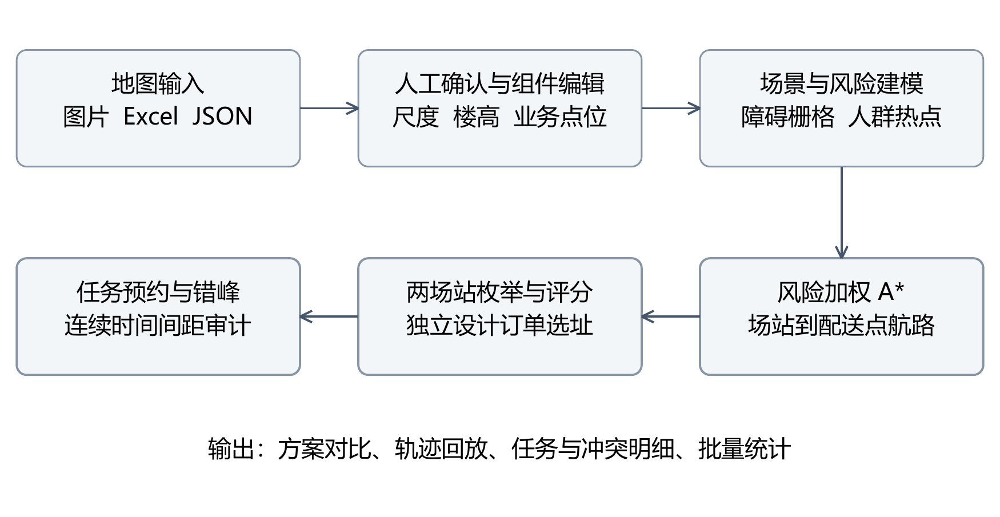
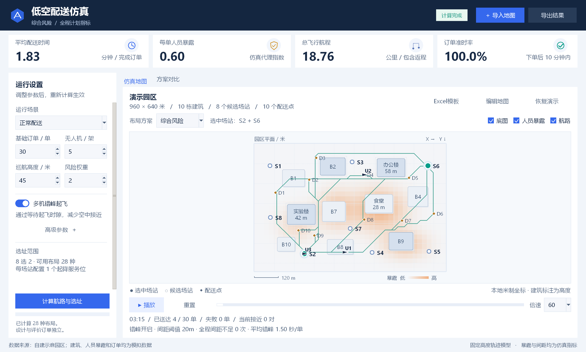
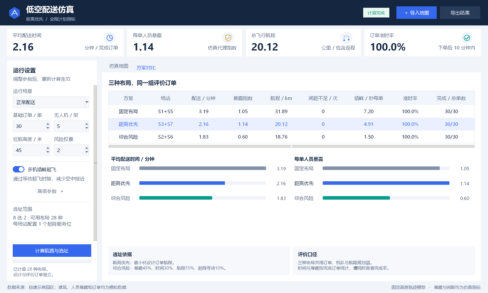
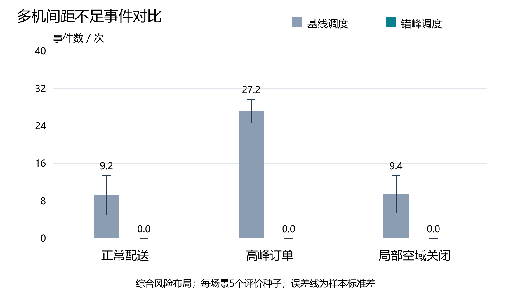
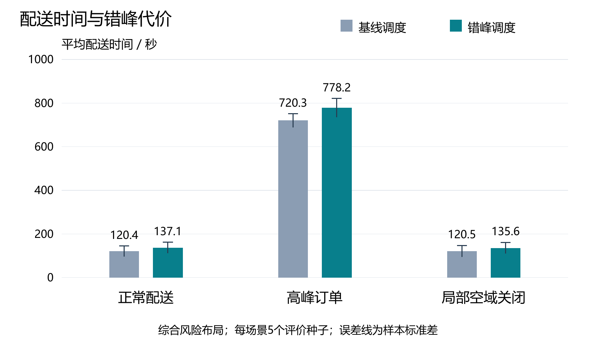
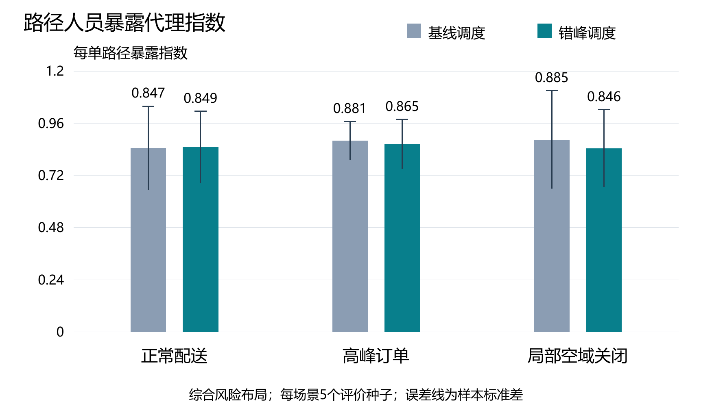

# 面向园区末端配送的低空风险仿真与起降场选址系统

中国仿真创新应用大赛｜数字建模与智能决策赛道｜智能决策方向

申请人（主持人）：

所在单位：

联系电话：

## 摘要

园区无人机配送的规划需要同时考虑建筑通行、人群暴露、起降场位置以及多架无人机对场站和空中时隙的竞争。单纯比较最短航程，难以解释同一地图中不同布局的时效与暴露差异。本作品建立固定巡航高度下的研究仿真系统，将地图编辑、风险加权航路、两起降场组合选址、订单分配和错峰预约放入同一计算流程。

系统主体使用Python实现，采用Tkinter提供桌面交互。地图支持图片、Excel和JSON输入；图片只提取建筑候选，用户确认米制尺度并手动填写楼高，随后可在程序内增删、移动和调整四类组件。模型使用八邻域A*搜索风险加权航路，以独立设计订单枚举和评价两个场站的组合；运行阶段选择最早可送达的无人机，并通过连续时间相对运动计算检查间距，必要时推迟起飞。

在960米×640米模拟园区中，对正常、高峰和固定局部空域关闭三种场景，采用5个独立评价种子、3种布局及2种调度，形成90条运行指标和45组配对比较。保存结果中的间距不足事件合计由700次降至0次，两种调度均无失败订单；按45组运行等权计算，平均配送时间增加35.53秒。正常场景的综合风险布局在错峰后每单路径暴露指数为0.849，低于距离优先布局的1.093，但配送时间由123.71秒增加至137.15秒。高峰场景仍存在明显超时，表明错峰不能代替容量扩充。

全部结果来自明确设定的模拟输入。人员暴露是相对代理指标，间距结论只适用于固定高度、匀速折线及悬停模型；本作品尚未完成真实飞行验证。现阶段成果适合方案比较和模型教学，可作为接入经核实园区数据的基础。

关键词：低空配送；风险加权A*；起降场选址；连续时间间距检测；错峰调度；可编辑地图

## 1 引言

本作品面向校园或园区内的小范围末端配送，研究“选择哪两个候选场站、沿什么航路配送、何时安排各架无人机出发”三个相互影响的问题。项目不把三维画面复杂度作为研究目标，而以可解释的模型、可操作的地图和可复核的对照实验支撑决策。

针对使用者难以整理坐标文件的问题，系统允许直接导入地图图片，再确认尺度和楼高；针对场站位置改变后需要重做航路的问题，系统把地图转换成统一场景对象，自动更新障碍和风险；针对多机只做动画而不检查接近的问题，系统独立审计完整任务航迹，并记录接近时间、最小间距和涉及订单。

报告依次说明需求与范围、数据组织、算法与系统实现、配对实验和应用流程。算法部分采用标准A*思想[1]，本作品的主要工作在于模型组合、编辑交互、预约约束和证据导出。对“最优”的表述限定在给定离散图或有限候选集合内，不声称获得真实城市三维空域的全局最优解。

## 2 研究背景及意义

### 2.1 实际问题与评价目标

校园和园区配送具有服务范围相对集中、建筑密集、人员活动区域差异明显的特点。无人机可以缩短部分地面绕行，但直线飞行可能穿过高建筑投影或人群活动区域；候选起降场的距离优势，也可能被返航、起降排队和机队分配抵消。因此需要同时报告时间、航程、路径暴露、准时率、完成率及间距不足事件。

民用无人机优化研究涉及任务分配、航路、设施和作业约束，Otto等[2]对此进行了综述。Murray和Chu[3]研究卡车与无人机协同配送，Dorling等[4]研究无人机配送路径问题；Kong等[5]进一步按协同程度梳理相关模型。本作品选择固定场站服务园区的场景，将车辆协同、补能和多点串行配送留在研究范围之外，以便集中检验选址、路径暴露与错峰之间的关系。

本作品提出三个可用仿真检验的问题：其一，距离优先选址与综合风险选址是否形成可观察的权衡；其二，在相同订单、布局和航路下，错峰能否消除模型中的间距不足，以及付出多少时效代价；其三，订单高峰和固定空域关闭会如何改变方案表现。上述问题均通过保存输入和运行明细回答。

### 2.2 研究范围与假设

研究空间为本地米制平面，建筑附带高度属性，航路在一个给定巡航高度上搜索。该表示属于带建筑高度约束的二维规划，不包含连续三维机动。无人机按恒定速度沿折线飞行，配送处理和返场排队可发生悬停；每架无人机固定归属一个场站，每个场站只有一个共享起降服务位，任务完成返场服务后才能执行下一单。

建筑高度、尺度、候选场站和人群热点属于输入条件。图片中的楼高不能可靠推断，必须手动录入；人群热点权重为研究设定，没有用未经采集的真实人数代替。20米空中间距、8米建筑平面间距与5米垂直间距均为模型参数，不能直接用作监管或运营标准。

### 2.3 应用价值与证据要求

系统的直接价值是降低地图试配和方案比较的操作门槛，使用户能够修改一栋建筑的高度、一个场站的位置或一处需求权重，并重新计算其影响。结果保留到订单和航路层级，便于解释“为何绕行”“为何等待”“为何未完成”。真实部署还需补足场地、气象、能耗、定位与运行规则等证据，本报告不据模拟结果推算营业收入或实际事故率。

## 3 研究内容与方案

### 3.1 系统结构与数据流程

系统将交互与核心计算分离。地图编辑器负责输入和校验；仿真引擎根据统一场景建立栅格和航路库，完成场站设计、订单评价及任务预约；间距模块对分段航迹做解析检测；导出模块输出JSON、CSV和SVG。界面计算在后台线程执行，回放直接使用保存的任务时间，避免“动画位置”和计算结果不一致。图1给出主要流程。



图1 从地图输入到可复核结果的系统流程

地图一经成功导入便保存为内存快照。磁盘文件被改动不会悄悄改变已计算结果；重新导入或应用编辑后才生成新场景。参数发生修改时，界面提示重新计算，再允许按新结果回放和导出。模型错误和输入错误均保留原场景，避免半完成的编辑污染当前结果。

### 3.2 场景对象与数据来源

统一场景包含地图宽高、网格步长、建筑、候选起降场、配送点、人群风险区及数据来源说明。坐标原点位于地图左上角，X向右、Y向下，平面坐标和建筑高度单位均为米。建筑以轴对齐矩形近似，允许多个矩形描述复杂建筑；目前未采用精确多边形或倾斜建筑模型。

表1 核心场景字段及其作用

|对象|主要字段|模型用途|
|---|---|---|
|地图设置|宽、高、步长、来源|统一米制尺度和离散范围|
|建筑|编号、位置、长宽、高度|判断固定高度下的障碍|
|候选场站|编号、名称、坐标|枚举两个场站的组合|
|配送点|编号、坐标、需求权重|订单目的地及抽样权重|
|人群区|中心、椭圆半径、权重|形成相对暴露风险场|

本次实验输入为项目内自建模拟园区data/demo_scene.json：宽960米、高640米，含10栋建筑、8个候选场站、10个配送点和4个人群热点。建筑名称仅用于示意，不代表已经调查的真实校园。图2为图片导入示例，定量实验统一使用上述JSON场景。校园卫星截图尚缺尺度、楼高和业务点位，未纳入定量结果。

实验输入和结果的完整性以文件校验值记录于附录。数据说明同时保留“模拟、估计或核实”的来源要求：当前数据属于模拟；未来导入实际园区时，应逐项记录图源、获取日期、尺度依据、楼高依据、人工修正记录和需求估计口径。仅更换一张底图，不等于建立了经核实的真实案例。

### 3.3 图片导入与可编辑组件

图片导入使用Pillow在本地处理。程序依据颜色阈值获得候选掩膜，通过形态学开运算减少文字与细线干扰，再提取连通区域并生成轴对齐矩形候选。提供灰色、暖色、蓝灰及手动取色等模式，用户可以调整颜色容差和最小面积。该方法适合颜色相对规整的平面地图；复杂卫星图、阴影、树冠和旋转建筑可能造成误检或漏检，目前没有经过卫星建筑分割准确率评估。

导入后必须确认整图宽度或通过两点已知距离定标。若已知实长为L、对应像素距离为d，则比例s=L/d；平面位置和尺寸按该比例转换。建筑高度独立于平面比例，缩放地图不修改楼高。用户逐栋或批量填写楼高；未确认尺度、仍有未填写高度时，程序阻止直接仿真并提示待补项目。


图2 地图组件编辑器与手动属性录入界面  模拟园区

建筑、起降场、配送点和人群区均为独立组件，可在程序内添加、删除、复制、拖动和编辑属性；建筑和人群区可拖动控制点调整尺寸。编辑支持撤销、重做、草稿保存和重开，JSON可嵌入底图，避免拷贝项目时丢失图片。道路和绿地目前作为底图参照，不参与独立通行计算；自动建议的业务点位仍需人工确认。

为改善放大时的可读性，底图最长边保留至3072像素并使用高质量重采样；大幅缩放时只裁切和绘制可视区域。Windows端启用原生高DPI感知，文字和控件按系统缩放显示。底图分辨率只影响显示，建筑几何与航路仍由米制组件数据计算。

### 3.4 建筑约束与人员暴露风险场

对巡航高度H和建筑高度h，若h+Δh≥H，则建筑成为该高度下的障碍，并在平面矩形外扩Δxy。本实验H=45米、Δh=5米、Δxy=8米。已知高度可以允许从较低建筑上方通行，但由于没有爬升下降过程，该结果只能用于给定高度平面的比较。固定关闭区在整次仿真中不可通行。

阻塞条件：h + Δh ≥ H；平面障碍为建筑矩形向外扩展 Δxy。

Primatesta等分别研究了城市环境中的无人机地面风险地图[6]与风险感知航路规划[7]，为在空间规划中显式考虑风险提供了研究依据。本作品以可编辑人员热点构造简化暴露场，用于比较航路；尚未复现文献中的完整地面风险模型，热点权重也未经过实际数据标定。

人员暴露场以基础值和椭圆高斯热点叠加构成，超过1时截断。热点的中心、椭圆半径及权重均可编辑。风险值表示路径经过该位置的相对地面人员暴露强度，不表示事故概率，也没有包含飞行器失效概率、坠落扩散和伤害后果。

r(x,y) = min{1, 0.035 + Σk wk exp[-2((x-xk)²/rxk² + (y-yk)²/ryk²)]}  （1）

路径暴露使用路段长度乘中点风险值的离散积分。由于任务沿去程原路返航，每单路径暴露指数为往返积分除以100；除数只是显示尺度。配送悬停和返场悬停虽然纳入间距检测，尚未计入该暴露指数。因此需要把它理解为“飞行路径暴露”，不能据此判断全部任务的总风险。

Rpath = Σe le r(me)；Eorder = 2Rpath / 100。  （2）

### 3.5 风险加权A星航路规划

程序以默认16米步长建立八邻域栅格。阻塞节点不可通行，对角移动禁止穿越阻塞拐角；线段连接还以不超过3米的间隔检查通行条件。起点和终点在邻近5×5栅格范围内选择最近可接入节点，并保留实际端点到节点的连接线。窄通道可能被栅格遗漏，连接采样也不构成精确CAD碰撞证明。

每条邻接边的代价由距离和暴露共同决定，其中λ为非负风险权重，本实验λ=2。启发函数使用到目标接入节点的欧氏距离。由于边代价不小于几何距离，该启发函数是下界；在当前图、已选接入节点和约束内，A*搜索得到最小加权代价的离散航路。标准算法依据见文献[1]。

c(u,v) = ||u-v|| [1 + λ r((u+v)/2)]。  （3）

f(n) = g(n) + h(n)；h(n) = ||n-goal||。  （4）

航路库为每个候选场站到各配送点预先计算路径并缓存距离、暴露与累计长度。改变地图、巡航高度或风险权重后重新建立航路库；改变订单种子时可以沿用同一规划条件下的航路。所有场站方案使用同一风险加权规划器，“距离优先方案”指场站评分以总航程为目标，不代表该方案另外使用了λ=0的最短距离航路。

本作品将算法核验和业务结果区分。小型构造场景中，测试使用独立Dijkstra搜索[8]计算同一图的目标代价，与A*输出对照至数值精度；另行检查端点、累计长度和每段通行性。该证据支持实现一致性，不能扩大为连续空间或任意地图上的精度认证。

### 3.6 两起降场选址与多指标评分

Hong等[9]从航程受限的补能站覆盖问题研究无人机配送设施布局。本作品在给定候选位置中选择两个起降场，比较其时效与暴露表现；当前模型没有补能网络与续航约束，因此选址结果不能直接替代文献所讨论的充电设施规划。

选择两个场站时，程序枚举所有可用候选场站的两两组合。默认8个候选均可用时共28个组合；障碍或关闭区中的候选先被排除。对每个组合使用相同设计订单和基线调度评价时间、路径暴露、总航程、场站等待及失败数。设计随机种子固定20365744，与所有评价种子分离。

各指标在本次候选集合内做min-max归一化。若该指标最大最小值相等，归一值取0；无成功订单导致指标缺失时取1。综合方案权重为暴露0.45、配送时间0.30、总航程0.15、场站等待0.10，每个失败订单附加1000分惩罚。距离方案采用归一化总航程和同样的失败惩罚。权重为当前研究设定，尚未通过实际偏好调查标定。

zq = (q-qmin)/(qmax-qmin)。  （5）

J综合 = 0.45z暴露 + 0.30z时间 + 0.15z航程 + 0.10z场站等待 + 1000N失败。  （6）

J距离 = z航程 + 1000N失败。  （7）

固定布局优先使用S1与S5；若其中有候选不可用，则按可用列表顺序补足。综合和距离方案在候选集合内选择评分最小者，同分按场站编号确定，保证可复现。该枚举能获得给定候选集合、设计订单与评分规则下的最小分组合，不能声称获得连续选址或城市规模选址的全局最优。

为使调度配对实验可比较，站点设计统一关闭错峰，之后冻结站点，在独立评价订单上比较两种调度。本版属于先选址、再调度的顺序优化，尚未把空中预约约束纳入选址联合优化。候选规模增大后组合数量按m(m-1)/2增长，城市规模计算应采用筛选、分解或近似方法。

### 3.7 订单生成与场站资源预约

订单生成使用可复现伪随机数，根据配送点需求权重抽取目的地，再生成订单创建时刻。正常和关闭场景为30单、到达窗口1200秒；高峰为60单、到达窗口800秒。到达时间为均匀随机数映射并取整，不将其描述为经过数据拟合的泊松过程。默认订单从创建起600秒内完成配送为准时。

5架无人机按顺序归属两个选定场站，通常形成3架与2架的配置。订单按创建时刻、编号依次处理；每个候选无人机需同时满足空闲、场站起飞服务可用、航路可达等条件。程序先计算最早起飞准备时隙，完成25秒准备后出发，以9米/秒飞向目的地，处理20秒后返航，返场占用20秒降落服务。每个场站的起飞和降落共用一份日历。

在可行候选中选择最早送达者，同分按无人机编号确定。日历一经预约不被后续订单调整，属于按订单顺序的贪心预约，并不保证全局最短等待。平均配送时间包含等待无人机、场站排队、错峰、去程和配送处理；订单送达后返航和降落不再计入该单配送时间，但会影响后续任务可用时刻。

### 3.8 连续时间间距检测与错峰

每次配送任务的空中部分拆分为去程折线、目的地悬停、返程折线和必要的返场悬停。起飞准备和降落服务视为地面阶段，不参与当前空中间距判断。两架无人机在重叠时间区间内的相对位置为r+vτ，求解二次不等式即可得到距离严格小于阈值的时间区间，不依赖逐秒采样。基于预测航迹检查间距属于冲突检测问题，相关建模方法的综述可参见Kuchar和Yang[10]。

||r + vτ||² < dmin²。  （8）

检测输出接近开始与结束时刻、最接近时刻、最小距离及对应订单。对同一任务对跨越航路折点但时间连续的片段进行合并，计为一次事件。冲突累计时长是每个任务对接近时长之和，同一时刻若有多对接近会分别累计。本文使用“间距不足事件”表示上述模型判据，不把它等同于真实碰撞。

启用错峰后，对每架候选无人机，先按场站日历确定基准准备时隙，再检查完整候选任务与已接受空中预约。发现接近时按5秒步长推迟请求时刻，并重新计算场站服务及返场等待；最大额外推迟为600秒。选择最早可送达的可行任务；全部候选都超限时记录airspace_delay_limit失败，无航路时记录unreachable失败。

场站等待定义为原起飞排队与返场排队之和，错峰等待单列为相对基准准备时隙的额外推迟。由于推迟还会影响后续任务可用时间，平均配送时间的增量通常大于单列错峰等待。整个排程完成后，程序再次独立检测所有航迹，包括基线调度，以防仅因调度分支未检查而漏报。

该方法只调整任务出发时刻，不改变已接受预约，也没有在飞行途中进行避碰控制或突发重规划。5秒离散搜索和600秒上限可能拒绝实际存在其他解的订单；模型内零间距不足不代表真实航空安全保证。

在动态环境规划方面，Phillips和Likhachev[11]提出以安全时间区间组织搜索的SIPP；Sharon等[12]提出面向多智能体路径规划的冲突搜索方法。两者为后续时空规划提供了参照。本作品使用既定航路和顺序预约，仅搜索出发时刻，未实现SIPP或CBS，也未获得这些方法所研究的多智能体最优性保证。

### 3.9 桌面界面与结果导出



图3 主界面与航迹回放  模拟园区单次运行示例

主界面集中提供场景、订单量、巡航高度、风险权重、机队规模及错峰开关。地图显示建筑、风险热区、候选和入选场站、配送点及无人机位置；用户可切换图层、播放暂停、拖动时间与调整倍速。基线发生接近时以标记突出位置；方案对比页展示各布局的多项指标。



图4 三种场站布局的对比界面  单次结果不等于批量均值

完整JSON保存场景、参数、种子、候选评分、航路、订单、任务、服务日历和冲突事件；CSV便于核对指标、任务和失败类型，SVG便于放大查看地图及对比图。批量实验另行输出原始运行表、配对差值表、汇总表和清单。MATLAB脚本可作为后续绘图入口，本机尚未实际运行，不把它列为已验证的软件联动成果。

### 3.10 实验设计与评价口径

采用3种场景×5个评价种子×3种布局×2种调度的完整方案组合，得到90条运行指标和45组配对比较。每个场景先使用设计种子选址一次，随后在评价种子20261015至20261019上复用布局。种子只是随机流标识，不是实测日期。每一组比较使用相同订单、航路、布局、无人机数量和服务参数，仅改变错峰开关。

表2 仿真主要参数

|参数|设定|说明|
|---|---|---|
|模拟园区|960×640米|10栋建筑，8候选场站，10配送点|
|巡航与栅格|45米；16米|固定高度，八邻域|
|建筑间距|平面8米；垂直5米|研究参数|
|风险权重|λ=2|所有布局共用|
|机队与速度|5架；9米/秒|场站固定归属|
|服务时间|起飞25秒；降落20秒；配送20秒|每场站一个服务位|
|准时阈值|下单后600秒|含等待与配送处理|
|错峰参数|间距20米；步长5秒；上限600秒|研究设定，非监管标准|
|订单负荷|正常30单/1200秒；高峰60单/800秒|模拟随机到达|
|关闭区域|(470,200)，宽75，高150米|整次运行生效，按地图比例缩放|

关闭场景中，关闭矩形在建图前设置，并在设计和评价全过程生效。每种场景分别重新选址，因此这里比较的是在各自已知条件下设计的方案，不能用来证明同一布局对途中突发关闭的鲁棒性。

平均配送时间和平均暴露以成功订单为分母；完成率与准时率以全部订单为分母，失败订单计为未完成和未准时。报告同时检查失败数，以避免只在成功子集上获得好看的均值。90条指标是方案评价记录，不是90次真实飞行；相同订单流在不同方案中重复评价，合计事件和完成次数不代表独立业务量。

完成率 = N成功/N总；准时率 = N按时送达/N总。  （9）

平均配送时间 = Σ成功订单(t送达-t创建)/N成功。  （10）

汇总表对同一场景、布局和调度的5个评价种子计算均值及样本标准差。误差线为样本标准差，不是置信区间；5个种子只提供初步稳定性证据，不据此声称统计显著或普遍有效。

### 3.11 实验结果与时效权衡

保存的45组配对结果中，基线间距不足事件合计700次，错峰为0次；两种调度均无失败订单，完成率均为100%。按45组运行的平均配送时间差值等权计算，错峰增加35.53秒，该值不按订单数加权。表3给出全部布局的间距事件和配送时间，图5、图6展示综合风险布局的变化。

表3 五个评价种子的间距事件与配送时间

|场景与布局|间距不足事件<br>基线→错峰 / 次|平均配送时间<br>基线→错峰 / 秒|
|---|---|---|
|正常配送<br>固定布局|10.00 ± 2.92 → 0|138.17 → 166.12|
|正常配送<br>距离优先|10.40 ± 3.51 → 0|103.21 → 123.71|
|正常配送<br>综合风险|9.20 ± 4.27 → 0|120.43 → 137.15|
|高峰订单<br>固定布局|26.20 ± 6.38 → 0|799.19 → 882.68|
|高峰订单<br>距离优先|27.20 ± 2.49 → 0|720.31 → 778.18|
|高峰订单<br>综合风险|27.20 ± 2.49 → 0|720.31 → 778.18|
|局部空域关闭<br>固定布局|9.80 ± 2.86 → 0|138.17 → 159.94|
|局部空域关闭<br>距离优先|10.60 ± 3.78 → 0|114.67 → 133.18|
|局部空域关闭<br>综合风险|9.40 ± 4.04 → 0|120.51 → 135.58|

表3间距事件给出基线均值±样本标准差；错峰9种组合均为0±0次。配送时间栏为跨种子均值。完整的时间与其他指标标准差见附录所列summary.csv，避免仅凭表中均值判断稳定性。



图5 综合风险布局的间距不足事件  均值与样本标准差



图6 综合风险布局的平均配送时间  均值与样本标准差

表4 人员路径暴露 错峰等待与准时率

|场景与布局|暴露指数<br>基线→错峰|错峰等待<br>秒/单|准时率<br>基线→错峰 / %|
|---|---|---|---|
|正常配送<br>固定布局|0.884 → 0.928|5.97|100.0 → 100.0|
|正常配送<br>距离优先|0.998 → 1.093|3.17|100.0 → 100.0|
|正常配送<br>综合风险|0.847 → 0.849|2.92|100.0 → 100.0|
|高峰订单<br>固定布局|0.983 → 0.957|13.11|36.3 → 32.3|
|高峰订单<br>距离优先|0.881 → 0.865|12.42|39.3 → 39.0|
|高峰订单<br>综合风险|0.881 → 0.865|12.42|39.3 → 39.0|
|局部空域关闭<br>固定布局|0.896 → 0.931|4.73|100.0 → 100.0|
|局部空域关闭<br>距离优先|1.122 → 1.150|5.29|100.0 → 100.0|
|局部空域关闭<br>综合风险|0.885 → 0.846|3.31|100.0 → 100.0|

表4各值均为5个评价种子的均值。所有组合完成率均为100%、失败数均为0；准时率反映完成时间而非能否最终完成。暴露指数没有纳入悬停，不能把错峰后指数下降解释为全部任务风险降低。



图7 综合风险布局的每单路径暴露指数  均值与样本标准差

### 3.12 结果解释与方案选择

正常场景下，固定、距离优先和综合风险布局分别选中S1+S5、S3+S7和S2+S6。错峰后距离优先的平均配送时间为123.71秒、每单暴露1.093；综合风险为137.15秒、暴露0.849。综合方案的暴露均值相对距离方案降低约22.3%，同时配送时间增加13.44秒，体现当前权重下对人员活动区域的回避代价。该相对差异只针对所设地图和需求。

高峰场景中，距离优先与综合风险均选中S6+S8，因此两者结果相同。错峰后平均配送时间778.18秒，准时率39.0%；固定布局为882.68秒和32.3%。虽然所有订单最终完成，运行仍不满足大部分订单600秒内送达的时效目标。可优先研究增加机队、调整站点归属和服务能力，而不是通过放宽间距来掩盖拥堵。

关闭场景中，综合风险布局错峰后的平均配送时间135.58秒、暴露0.846；距离优先为133.18秒、暴露1.150。两者时效接近，但路径暴露差异明显，说明在本场景下仅按航程选址会遗漏人群分布。由于每个场景重新设计站点，这仍不是对同一站点组合的突发事件应对验证。

错峰可能使无人机选择发生变化，而各机固定归属的场站不同，因而总体航程与暴露也可能变化；不能假设“只推迟时间”就一定使全部路径指标保持不变。另一方面，暴露没有覆盖悬停，现有指标不足以计算等待带来的完整风险和能耗代价。

### 3.13 软件验证与可复现性

2026年10月17日使用配套Python执行python -m unittest discover -s tests -v，41项测试全部通过，耗时16.919秒。覆盖航路目标代价、建筑约束、资源不重叠、连续时间接近、错峰失败、数据导出、Excel校验、图片处理、组件编辑及草稿状态等。测试用于核查实现是否符合既定模型；模型是否代表现实仍需要外部数据与实地验证。

表5 已执行的关键核验

|核验对象|核验方式|结果与边界|
|---|---|---|
|航路正确性|与独立Dijkstra代价对照；端点与通行性检查|通过；限当前离散图|
|调度约束|无人机任务和共享服务位时段不重叠|通过；预约式模型|
|间距检测|亚秒交叉、悬停、相切、时间不重叠、事件合并|通过；分段匀速模型|
|失败统计|不可达、错峰超限及分母检查|通过；保留失败原因|
|地图编辑|高度修改、定标、撤销重做、JSON往返|通过；高度保持手动|
|图片显示|细线保留、大图缩放、自包含底图|通过；不代表识别精度|
|界面检查|大小窗口、高DPI、编辑与回放操作|历史检查通过；详见验证记录|

现有桌面检查记录覆盖主界面1380×830与1120×720逻辑窗口、编辑器1280×840与1000×680逻辑窗口，以及本机200%缩放。高DPI显示和底图对齐已有操作检查，未据此声称对所有操作系统与显示设备完成兼容性认证。

复现步骤为：保留完整项目目录，使用含Tkinter的Python 3.10以上环境；图片导入额外安装Pillow。先用内置JSON运行单次结果，再使用独立输出目录运行配对实验，对照90条原始指标、45条差值和汇总表。参数、种子和数据文件路径随manifest保存。各文件和命令见附录A。

### 3.14 实际地图接入与应用流程

实际使用时先选定边界清晰的小型园区，从具有使用权限的图源获得清晰地图并记录出处。通过已知边长或两点实距建立尺度，核查旋转、透视和拼接影响；用管理资料、测绘资料或明确标注的估计方法填写建筑高度。对长条、倾斜或连体建筑，应使用多个矩形保守近似并人工检查。

随后在编辑器中核实可用起降位置、配送位置和需求权重，删除不符合实际场地条件的候选。人群区应依据调查或可追溯假设设置，不能把图上颜色当作人群密度。确认数据完整后保存JSON，先检查不可达航路和异常任务，再进行多方案、多种子比较。

用于方案讨论时，应同时展示时间、准时率、完成率、路径暴露和间距事件，并能从异常指标回查具体订单。导出结果可供教师或园区管理者讨论站点与容量；现场实施前，还需单独完成场地、机型、气象、能源、通信和运行规则的核实，本系统输出不代替这些工作。

## 4 特色与创新之处

### 4.1 可编辑地图与算法输入直接衔接

将导入图片后的建筑候选转成可编辑模型组件，要求人工确认尺度和楼高，使用户可以通过修改实际影响航路的几何与高度来调整模型。编辑结果直接进入同一仿真引擎，减少底图展示与计算地图脱节的问题。创新定位为面向使用过程的工程集成，尚未提出新的建筑识别算法。

### 4.2 风险选址与连续时间调度串联

在一个原型内贯通风险加权航路、有限候选组合选址、场站服务预约和连续时间间距检测，使用户能够从“选址评分”追溯到“路径与任务”，再解释错峰代价。相较只展示最短航线或飞行动画，系统提供间距事件位置及任务时间证据；现阶段仍是顺序优化，不把模块组合包装为已证明的联合最优算法。

### 4.3 配对设计与可审计输出

采用独立设计订单冻结场站，再在共享评价订单上切换错峰，减少因重新选址和重新生成订单而混淆比较的风险。错峰等待、场站等待、失败订单及准时率分别记录；原始运行表、配对差值、完整任务JSON和文件校验值共同支撑复核。当前结果明确呈现效率代价和高峰不足，保留对方案不利的信息。

## 5 总结

本作品已经形成可运行的Python桌面仿真原型，实现地图导入与组件编辑、固定高度障碍建模、风险加权A*、两个场站组合选址、订单分配、共享服务预约、连续时间间距检测和错峰出发。41项测试通过，模拟园区90条运行指标和45组配对结果可以复核。现有证据支持在所设模型中通过错峰消除间距不足，并量化其时效代价。

研究同时暴露出三项主要限制：真实地图数据尚未校准；风险和飞行模型仍较简化；5个评价种子与单一模拟园区不足以支持普遍化结论。高峰场景的低准时率说明仅优化时隙不能解决容量不足。

后续优先建立一个有尺度、楼高和来源记录的实际园区案例，再围绕风险权重、机队规模、服务时间、栅格步长及间距阈值进行敏感性实验，增加评价种子并记录运行耗时。其后补入悬停能耗和暴露、风与定位误差，以及动态关闭重规划。真实应用验证应在这些条件逐步补齐后开展。

## 参考文献

[1] HART P E, NILSSON N J, RAPHAEL B. A Formal Basis for the Heuristic Determination of Minimum Cost Paths[J]. IEEE Transactions on Systems Science and Cybernetics, 1968, 4(2): 100-107. DOI: 10.1109/TSSC.1968.300136.

[2] OTTO A, AGATZ N, CAMPBELL J, et al. Optimization approaches for civil applications of unmanned aerial vehicles (UAVs) or aerial drones: A survey[J]. Networks, 2018, 72(4): 411-458. DOI: 10.1002/net.21818.

[3] MURRAY C C, CHU A G. The flying sidekick traveling salesman problem: Optimization of drone-assisted parcel delivery[J]. Transportation Research Part C: Emerging Technologies, 2015, 54: 86-109. DOI: 10.1016/j.trc.2015.03.005.

[4] DORLING K, HEINRICHS J, MESSIER G G, et al. Vehicle Routing Problems for Drone Delivery[J]. IEEE Transactions on Systems, Man, and Cybernetics: Systems, 2017, 47(1): 70-85. DOI: 10.1109/TSMC.2016.2582745.

[5] KONG J, WEI L, JIANG X. A Literature Review of Vehicle and Drone Delivery Routing Problems in Different Synchronization Level Scenarios[J]. Drones, 2026, 10(3): 206. DOI: 10.3390/drones10030206.

[6] PRIMATESTA S, RIZZO A, LA COUR-HARBO A. Ground Risk Map for Unmanned Aircraft in Urban Environments[J]. Journal of Intelligent & Robotic Systems, 2020, 97(3-4): 489-509. DOI: 10.1007/s10846-019-01015-z.

[7] PRIMATESTA S, GUGLIERI G, RIZZO A. A Risk-Aware Path Planning Strategy for UAVs in Urban Environments[J]. Journal of Intelligent & Robotic Systems, 2019, 95(2): 629-643. DOI: 10.1007/s10846-018-0924-3.

[8] DIJKSTRA E W. A note on two problems in connexion with graphs[J]. Numerische Mathematik, 1959, 1(1): 269-271. DOI: 10.1007/BF01386390.

[9] HONG I, KUBY M, MURRAY A T. A range-restricted recharging station coverage model for drone delivery service planning[J]. Transportation Research Part C: Emerging Technologies, 2018, 90: 198-212. DOI: 10.1016/j.trc.2018.02.017.

[10] KUCHAR J K, YANG L C. A review of conflict detection and resolution modeling methods[J]. IEEE Transactions on Intelligent Transportation Systems, 2000, 1(4): 179-189. DOI: 10.1109/6979.898217.

[11] PHILLIPS M, LIKHACHEV M. SIPP: Safe interval path planning for dynamic environments[C]//2011 IEEE International Conference on Robotics and Automation. 2011: 5628-5635. DOI: 10.1109/ICRA.2011.5980306.

[12] SHARON G, STERN R, FELNER A, et al. Conflict-based search for optimal multi-agent pathfinding[J]. Artificial Intelligence, 2015, 219: 40-66. DOI: 10.1016/j.artint.2014.11.006.

## 附录A 代码与复现索引

以下路径均以配套Python项目根目录为起点。报告引用的运行数据来自results/safety，截图来自docs/images；新增地图编辑能力的核验见tests及docs/验证记录.md。报告制作未重写保存的实验数据。

表A1 程序与证据文件

|相对路径|内容|
|---|---|
|run.py|桌面、单次、批量与配对实验入口|
|engine.py|场景、风险、A*、场站评分、任务调度|
|airspace.py|分段航迹及连续时间间距审计|
|image_map.py|本地建筑候选提取与底图处理|
|map_document.py|组件事务、校验、定标、撤销重做|
|map_editor.py|可视化地图编辑和手动楼高|
|map_import.py|Excel/JSON导入与字段定位|
|app.py、ui.py、display.py|界面、回放、高DPI与地图绘制|
|reporting.py、study.py|导出、配对差值及统计报告|
|tests/|41项自动核验|
|data/demo_scene.json|本报告模拟场景输入|
|results/safety/|原始、汇总、配对表与30份运行JSON|
|docs/验证记录.md|桌面与高DPI历史检查记录|
|matlab/analyze_results.m|可选分析脚本，尚未实际运行验证|

在项目目录运行下列命令。为保留本报告证据，重新运行实验时使用新的输出目录results/report_reproduction；该目录可与results/safety逐项比较。测试不修改实验结果。

```powershell
python run.py
python -m unittest discover -s tests -v
python run.py --mode safety `
  --scene data/demo_scene.json `
  --output results/report_reproduction
```

单次导出包含result.json、comparison.csv、jobs.csv、failed.csv、conflicts.csv、map.svg和comparison.svg。配对实验保存90条运行指标、45条配对记录和30份JSON，每份JSON中包含3种布局。summary.csv每个指标均有有效运行数、均值和样本标准差。

表A2 报告所用文件的SHA256校验值

|文件|SHA256|
|:---:|:---:|
|data/<br>demo_scene.json|f7334c3edcadbc67587a8af390037d42<br>8c0b4b93d65e7262d9bff3ffb4201e38|
|results/<br>safety/<br>manifest.json|c12eb439409264138601d44c1fb9afbf<br>2632a7ecca655caee49fe7399392f1ab|
|results/<br>safety/<br>raw_metrics.csv|4f3f5b1cdfb0a7f3777f3b1fa0c97762<br>1e76e9e1524163097949b0e83574e2b4|
|results/<br>safety/<br>paired_comparison.csv|985b1634f259b02ac5c1d25d1faffd78<br>c2161b2ddbeef3edab7b6ba5791314a7|
|results/<br>safety/<br>summary.csv|8fbbd3db56106c0a6f945e3ee17a3d2b<br>6690134940654661f31832a933e70b52|

注：路径在“/”后换行，SHA256值按32位分行；校验时按顺序拼接，不包含换行。

## 附录B 人工智能辅助使用说明

本项目使用OpenAI Codex/ChatGPT开展生成式人工智能辅助工作，涉及选题与模型讨论、Python程序和测试脚本编写及修改、界面和地图编辑功能迭代、说明文字整理、报告初稿、表格排版及图表制作。报告的模型说明、结果分析和总结段落为AI辅助整理内容，应由参赛团队结合代码与原始结果审核后采用。

实验表格和统计图读取已保存的CSV生成，界面图片为程序运行截图，未使用生成式图片冒充地图、实验现象或真实飞行记录。数据均为模拟输入；没有生成参赛人员、单位、联系方式、手写签名、实际测绘数据、专利或论文成果。

AI辅助不能替代参赛者对原创性、数据真实性、软件许可和结论的责任。参赛团队应依据官网《参赛指南》（https://www.siac.net.cn/article/2）及《竞赛诚信规范手册》（https://www.siac.net.cn/article/26）核对允许的使用范围，如实补充个人实际工作、审核与修改记录，并在正式提交前完成模型理解、数据核查和承诺书手写签署。
